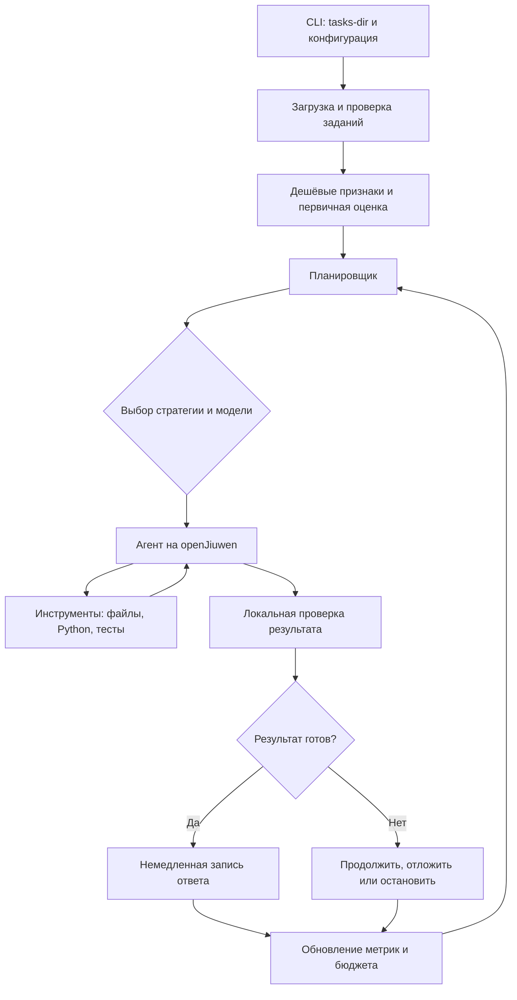

# Подробный разбор openJiuwen Challenge 2026

Дата анализа: **7 ноября 2026 года**. Документ описывает локальную копию проекта на эту дату.

## 1. Что это за проект и какую задачу предстоит решить

Проект посвящён соревнованию по созданию **харнесса кодового агента на базе openJiuwen**. Харнесс — управляющая программа вокруг языковой модели: она получает задания, выбирает порядок их решения, вызывает модель и инструменты, проверяет результат, учитывает расходы и сохраняет ответы.

Главная цель — получить **максимальную сумму баллов при ограниченном общем бюджете токенов и времени**. Для этого недостаточно сделать агента, который умеет исправлять Python-код. Требуется система принятия решений: какие задачи брать, сколько ресурсов им выделять, когда менять модель и когда прекращать попытку.

В финальном запуске обещаны 100 задач. В текущей папке находятся **8 демонстрационных задач**, по две каждого типа: `math`, `search`, `data_analysis`, `coding`. Сумма их наград — **20 баллов**. Согласно локальному регламенту, все примеры выполнимы, а в финальном наборе ориентировочно 15–25% задач будут невыполнимыми.

Сейчас репозиторий — **исходные материалы для разработки**. Реализация харнесса, Dockerfile, точка входа и интеграция с openJiuwen отсутствуют.

### Как читать документ

- **Факт** — подтверждён локальными файлами или выполненной проверкой.
- **Требование** — содержится в локальном регламенте; это ещё не подтверждение поведения инфраструктуры организаторов.
- **Предложение** — рекомендуемое инженерное решение, которого в проекте пока нет.
- **Неопределённость** — вопрос, на который имеющиеся материалы не дают однозначного ответа.

Цель этого анализа — объяснить постановку, текущее содержимое проекта и подходы к будущему решению. Разработка агента, изменение демонстрационных задач, настройка внешних сервисов и сдача решения в рамки этой работы не входят.

## 2. Источники и границы проверки

Основные локальные источники:

1. [Регламент соревнования](Регламент%20соревнования.md).
2. Восемь `task.json` внутри [каталога примеров](task-dir/task-dir/).
3. `mylib.py` и `test_mylib.py` в двух задачах `coding`.
4. `sales.csv` в двух задачах `data_analysis`.
5. Все Markdown-файлы двух локальных баз знаний `kb/`.
6. Структура репозитория, состояние Git и имена переменных из `.env.example`.

Для общего объяснения openJiuwen также проверен [официальный репозиторий agent-core](https://github.com/openJiuwen-ai/agent-core). Официальное описание представляет его как Python SDK для создания агентов, организации workflow, вызова моделей и инструментов. Это подтверждает назначение фреймворка, но не доказывает совместимость конкретной его версии с прокси соревнования.

Выполнены локальные вычисления, проверка исходных тестов и проверка минимальных исправлений в **временных копиях**. Не выполнялись вызовы LLM-прокси, установка openJiuwen, сборка Docker или полный агентный прогон. Содержимое `.env` не читалось.

## 3. Что находится в репозитории

```text
openJiuwen-Challenge-2026/
├── LICENSE
├── .env                       # локальные настройки; значения не анализировались
├── .env.example               # LLM_BASE_URL и LLM_API_KEY
├── .gitignore                 # на момент анализа пустой
├── .idea/                     # файлы IDE
├── Регламент соревнования.md
├── PROJECT_ANALYSIS_RU.md      # данный документ
└── task-dir/
    ├── __MACOSX/              # служебные метаданные распаковки
    └── task-dir/              # фактический корень восьми примеров
        ├── math_0000/task.json
        ├── math_0004/task.json
        ├── search_0001/
        │   ├── task.json
        │   └── workspace/kb/  # 36 документов
        ├── search_0005/
        │   ├── task.json
        │   └── workspace/kb/  # 38 документов
        ├── data_analysis_0002/
        │   ├── task.json
        │   └── workspace/sales.csv  # 20 строк данных
        ├── data_analysis_0006/
        │   ├── task.json
        │   └── workspace/sales.csv  # 300 строк данных
        ├── coding_0003/
        │   ├── task.json
        │   └── workspace/{mylib.py,test_mylib.py}
        └── coding_0007/
            ├── task.json
            └── workspace/{mylib.py,test_mylib.py}
```

### Практические выводы из структуры

1. При локальной разработке путь к примерам — **`task-dir/task-dir`**, с двойным уровнем вложенности. В финале путь будет приходить через `--tasks-dir`; привязываться к текущему имени папки нельзя.
2. `__MACOSX` и файлы `._*` не являются задачами. Обнаруживать задания следует по валидным `task.json`, а не по произвольным каталогам.
3. У `math_0000` и `math_0004` папки `workspace/` сейчас нет. Код запуска должен учитывать это различие, а не считать наличие `workspace/` обязательным для всех типов.
4. Файлы `mylib.py` — материал задач, который агент должен исправлять во время решения. Это не исходный код самого харнесса.
5. `LICENSE` содержит лицензию Apache 2.0. Отдельного манифеста зависимостей приложения в проекте нет.
6. `.env` уже присутствует в индексе Git, а `.gitignore` пустой. Перед будущим коммитом нужно проверить, что реальные учётные данные не попадут в историю или Docker-контекст. Это наблюдение о состоянии файлов, а не утверждение о наличии секрета в `.env`.

### Чего пока нет

| Компонент | Состояние на момент анализа |
| --- | --- |
| `run_agent.py` и CLI | Нет |
| Dockerfile | Нет |
| Подключение openJiuwen | Нет |
| Зафиксированные зависимости | Нет |
| Клиент LLM-прокси | Нет |
| Планировщик задач | Нет |
| Учёт и резервирование токенов | Нет |
| Оценщик стоимости и вероятности успеха | Нет |
| Исполнитель инструментов | Нет |
| Сохранение ответов агентом | Нет |
| Локальный оценочный стенд | Нет |
| README с инструкциями запуска | Нет |
| Собственный тренировочный набор и траектории | Нет в просмотренном дереве |

## 4. Формальная постановка соревнования

Для задачи `i` обозначим:

- `r_i` — награду из `reward`;
- `c_i` — фактический расход токенов;
- `t_i` — время решения;
- `y_i` — индикатор зачтённого решения: 1 или 0;
- `B` — общий токеновый бюджет;
- `T` — доступное время запуска.

Цель:

```text
максимизировать Σ r_i × y_i
при общем расходе всех LLM-вызовов ≤ B
и времени всего запуска ≤ T.
```

В расход входят также неудачные попытки, оценка задач и решения планировщика, если они используют LLM. Поэтому сумма затрат на успешно решённые задачи не отражает полный расход.

Награды, по регламенту, расставлены случайно и не связаны со сложностью. Следовательно:

- большая награда сама по себе не означает сложную задачу;
- маленькая награда не означает дешёвое решение;
- решать задачи в порядке каталогов — слабая исходная стратегия;
- можно выиграть у более сильного решателя за счёт более удачного распределения ресурсов.

При известных стоимости и исходе задача напоминает **задачу о рюкзаке**. Здесь стоимость и успех неизвестны заранее, а продолжение попытки даёт новую информацию. Поэтому точнее говорить о последовательном планировании в условиях неопределённости.

### Базовая оценка полезности

Для первого планировщика можно использовать эвристику:

```text
priority_i = reward_i × estimated_success_probability_i
             / estimated_remaining_token_cost_i
```

Это предложение, а не формула организаторов и не гарантия оптимального выбора. Знаменатель должен учитывать выбранную стратегию и модель. Нулевую или очень малую оценку нужно обрабатывать отдельно, чтобы не получить бессмысленное бесконечное значение.

Пример с условными числами:

| Задача | Награда | Вероятность успеха | Ожидаемая стоимость | Ожидаемые баллы / 1000 токенов |
| --- | ---: | ---: | ---: | ---: |
| A | 5 | 0,95 | 400 | 11,88 |
| B | 2 | 0,90 | 100 | 18,00 |
| C | 8 | 0,20 | 2000 | 0,80 |

В этом примере B выгоднее A по отношению ожидаемой награды к расходу. Однако окончательный набор зависит от остатка бюджета и времени: одна жадная сортировка не всегда даёт оптимальный результат.

## 5. Правила, ограничения и сдача

### 5.1. Модели

В локальном регламенте перечислены четыре разрешённых идентификатора:

- `qwen3.8-27b`;
- `qwen3.8-27b-noreason`;
- `qwen3.6-35b-a3b`;
- `qwen3.6-35b-a3b-noreason`.

Суффикс `-noreason` означает вариант без рассуждений. Модель можно менять на каждом вызове по решению планировщика.

Из названий нельзя вывести фактическое качество, задержку и стоимость успешного решения. Их надо измерять через разрешённый прокси. Не следует заранее объявлять одну модель «сильной», а другую «слабой» без данных.

### 5.2. Среда

| Ограничение | Что записано в регламенте |
| --- | --- |
| Сеть при запуске | Только прокси организаторов |
| Адрес и ключ | `LLM_BASE_URL`, `LLM_API_KEY` из окружения |
| GPU | Нет |
| RAM | Не более 16 ГБ |
| CPU | В таблице 4 ядра; в команде Docker — 8, требуется уточнение |
| Сессии агента | До 5 одновременно |
| Время работы | 1 час |
| Время сборки | 1000 секунд |
| Репозиторий без `.git` | Меньше 100 МБ |
| Образ или сумма образов | Меньше 4 ГБ |
| Локальные нейросетевые модели | Запрещены |
| Классическая регрессия и бустинг | Разрешены |
| Скачивание при запуске | Запрещено |

Отсутствие сети означает, что `search` здесь следует понимать прежде всего как поиск по предоставленным файлам. Нельзя закладываться на внешний веб-поиск или установку пакета в момент решения.

### 5.3. Файловая система контейнера

В опубликованной команде:

- корневая файловая система контейнера доступна только для чтения: `--read-only`;
- `/tmp` — записываемый `tmpfs` размером 2 ГБ;
- `HOME=/tmp`;
- каталог задач примонтирован в `/data/tasks` с правом записи;
- рабочий каталог — `/app`;
- запускается `/app/run_agent.py --tasks-dir /data/tasks` через `python`;
- удалены capabilities и запрещено получение дополнительных привилегий;
- ограничено число процессов.

Следствия для реализации: логи, временные файлы, кэши и результаты нельзя безусловно писать рядом с кодом в `/app`. Подпроцессу задачи нужно явно назначать её рабочий каталог. Для конкурентных задач нельзя использовать глобальный `os.chdir()`: это состояние всего процесса. Надёжнее передавать `cwd` каждому подпроцессу.

Контейнер ограничивает весь запуск. Если несколько задач выполняются в одном контейнере и имеют общий доступ к примонтированному дереву, само наличие Docker не обеспечивает изоляцию одной задачи от соседней.

### 5.4. Порядок проверки

1. Проверка безопасности образа с помощью LLM.
2. Сборка образа.
3. Отборочный прогон на двух выполнимых задачах: нужно решить обе в выданном бюджете.
4. Полный прогон с начислением баллов за прохождение скрытых тестов.

Неудача на любом из первых трёх этапов означает незачёт. При равенстве баллов выигрывает меньший расход токенов.

Оценивается последний коммит на момент закрытия соревнования. README должен объяснять сборку, запуск, оценку расхода, поиск невыполнимых задач и собранные траектории. Для приватного репозитория регламент требует доступ жюри `promsoft` и `madrugado`.

## 6. Неоднозначности регламента

Эти вопросы важно разрешить до окончательной реализации файлового контракта и бюджетного контроллера.

| Вопрос | Наблюдение | Временный инженерный подход |
| --- | --- | --- |
| Где сохранять ответ? | Регламент говорит о `answer.txt` в каталоге задачи; инструкции требуют файл в текущем каталоге, а данные лежат в `workspace/` | Разделить рабочий каталог и путь сдачи, изолировать запись в отдельном компоненте; точный путь подтвердить у организаторов |
| Нужен ли общий файл решений? | В начале раздела сдачи он упоминается, но последующая команда не передаёт выходной путь | Не считать контракт общего файла определённым |
| Что означает `OUT`? | Переменная упоминается и используется при создании папки, но не передаётся в контейнер и не монтируется в показанной команде | Не рассчитывать на доступность `OUT` внутри контейнера |
| Как передаётся бюджет? | По постановке агент получает бюджет, но в CLI и перечисленных переменных его нет | Сделать внутреннюю конфигурацию бюджета; внешний источник уточнить |
| Сколько CPU доступно? | 4 в таблице и `--cpus 8` в команде | До уточнения проектировать под 4 ядра |
| Как считать reasoning? | Есть правило учёта, но нет схемы ответа прокси | Проверить реальные `usage` и вложенность reasoning-полей |
| Какой API поддерживает прокси? | Есть URL и ключ, но нет контракта endpoints, streaming и tools | Не считать OpenAI-совместимость подтверждённой |
| Какие поля есть в финальных JSON? | В примерах присутствует `expected` | Не использовать эталон на стороне решателя |
| Как проверяется `answer.txt`? | Видны метки `exact_int`, `exact_str`, `unittest`, но нет кода оценщика | Не предполагать правила whitespace и расположение файла |
| Как определяются невыполнимые задачи? | Нет примеров таких задач и формального определения | Хранить основания отказа и проверять классификатор на собственном наборе |

В команде сборки также записано `docker build -t "hack:latest"` без явного контекста сборки. Для обычного локального запуска контекст нужно указать, например `.`. Вызов `timeout -k 1000s 1h` посылает сигнал по часовому лимиту и задаёт отдельную задержку до принудительного убийства. Это не основание рассчитывать на дополнительное время сверх часа.

В инструкциях задач `coding` сказано записать `DONE`, но пример команды содержит `echo 42 > answer.txt`. Это очевидное несоответствие примера требуемому значению: ориентироваться следует на явное требование `DONE`.

## 7. Формат задания и граница между решателем и оценщиком

Каждый просмотренный `task.json` содержит:

| Поле | Назначение | Как использовать |
| --- | --- | --- |
| `task_id` | Идентификатор | Логи, очередь, связь с файлами |
| `task_type` | Тип задачи | Выбор специализированной стратегии |
| `instruction` | Условие | Основной вход решателя |
| `reward` | Баллы | Планирование |
| `expected` | Эталон примера | Только независимая локальная оценка |
| `check` | Метка способа проверки | Локальный оценочный стенд; доступность в финале не гарантирована |

**Критически важно:** копирование `expected` в ответ ничего не говорит о способности агента решать задачи. Доступность эталона в демонстрационных JSON не является подтверждением допустимости такого подхода в соревновании.

Предлагаемая граница:

```text
Исходный пример
  ├─ решатель: task_id, task_type, instruction, reward, workspace
  └─ оценщик: expected, check, фактические артефакты решателя
```

Поле `expected` нужно исключать и из LLM-контекста, и из признаков оценки стоимости, и из вспомогательных файлов, доступных решателю. Простого удаления из одного промпта недостаточно, если bash-инструмент может прочитать родительский `task.json`. Для честного эксперимента нужна очищенная копия входа и контроль доступных путей. Эту же границу следует соблюдать при генерации тренировочных задач.

Метки проверки в примерах:

- `exact_int`: ожидается целое число;
- `exact_str`: ожидается точная строка;
- `unittest`: требуется работоспособный изменённый код.

Это смысловые интерпретации меток. Реализация официального сравнения и правила завершающего перевода строки не представлены. Безопасная стратегия для ответов — только требуемое значение, без пояснений, Markdown и кавычек.

## 8. Подробный разбор всех восьми задач

### 8.1. Сводная таблица

| Задача | Тип | Баллы | Проверенный результат |
| --- | --- | ---: | --- |
| `math_0000` | Арифметика | 5 | `389` |
| `math_0004` | Арифметика | 2 | `1735` |
| `search_0001` | Поиск факта | 1 | `1983` |
| `search_0005` | Поиск по двум связанным документам | 2 | `Osaka` |
| `data_analysis_0002` | Фильтрация CSV и сумма | 3 | `158` |
| `data_analysis_0006` | Фильтрация CSV и сумма | 3 | `284` |
| `coding_0003` | Исправление Python | 2 | 6/6 видимых тестов после двух исправлений во временной копии |
| `coding_0007` | Исправление Python | 2 | 4/4 видимых тестов после двух исправлений во временной копии |

Таблица — результат анализа примеров. Она не является результатом прогона харнесса: агент ещё не реализован, файлы `answer.txt` не создавались.

### 8.2. `math_0000`: последовательные преобразования запаса

Источник: [условие](task-dir/task-dir/math_0000/task.json).

Начальный запас — 1752 коробки. Нужно последовательно делить запас с округлением вниз и удваивать его:

```text
1752 // 2 = 876
876 × 2   = 1752
1752 // 3 = 584
584 × 2   = 1168
1168 // 3 = 389
```

Главная тонкость — округление на каждом указанном шаге. Нельзя сначала алгебраически объединять все действия и округлять только итог, если это изменяет промежуточные значения.

Проверка на Python:

```python
stock = 1752
stock //= 2
stock *= 2
stock //= 3
stock *= 2
stock //= 3
assert stock == 389
```

Задача имеет наибольшую награду среди примеров — 5 баллов — при коротком вычислении. Это наглядно показывает, почему награду нельзя принимать за сложность.

### 8.3. `math_0004`: отгрузки и поставки

Источник: [условие](task-dir/task-dir/math_0004/task.json).

```text
Начальный запас: 1669
Отгрузки:       36 × 3 = 108
Поставки:       2 × 87 = 174
Итог:           1669 − 108 + 174 = 1735
```

Типичный риск — перепутать число поставок и размер поставки либо знак движения запаса. Сама арифметика должна выполняться инструментом, как требует инструкция, а не только языковой моделью.

### 8.4. `search_0001`: поиск года рождения

Источник: [условие](task-dir/task-dir/search_0001/task.json), [карточка Irina Smith](task-dir/task-dir/search_0001/workspace/kb/person_irina_smith.md).

Вопрос: в каком году родилась Irina Smith? В соответствующей карточке:

```text
# Irina Smith
Born: 1983
Employer: Dune Robotics
Mentor: Alice Smith
```

Ответ — `1983`. В этой базе 36 документов: 10 компаний и 26 людей. Для решения достаточно найти точную сущность и извлечь `Born`. Год основания компании, год рождения наставника и человек с похожим именем не относятся к вопросу.

Пример поиска из рабочей папки задачи:

```bash
rg -n '^# Irina Smith$|^Born:' kb/person_irina_smith.md
```

В будущем образе наличие `rg` нужно обеспечить при сборке либо использовать доступные `grep`/Python.

### 8.5. `search_0005`: связь «человек → работодатель → город»

Источники: [условие](task-dir/task-dir/search_0005/task.json), [человек](task-dir/task-dir/search_0005/workspace/kb/person_sergei_garcia.md), [компания](task-dir/task-dir/search_0005/workspace/kb/company_fjord_data.md).

Нужно узнать город штаб-квартиры работодателя Sergei Garcia:

```text
Sergei Garcia
  Employer: Fjord Data
    Headquarters: Osaka
```

Ответ — `Osaka`. В этой базе 38 документов: 10 компаний и 28 людей.

Это пример многошагового поиска: первая карточка определяет вторую. Для более длинных цепочек полезна модель графа: сущности — вершины, `Employer` и `Mentor` — связи. При циклах и ограниченной глубине обхода нужен контроль посещённых узлов.

**Базы разных задач нельзя объединять без учёта происхождения.** Например, в `search_0001` у Fjord Data штаб-квартира в `Quito`, а в `search_0005` — в `Osaka`. Глобальный кэш только по имени компании приведёт к неверным ответам. Ключ кэша должен учитывать задачу или содержимое её workspace.

### 8.6. `data_analysis_0002`: сумма продаж за месяцы 7–8

Источники: [условие](task-dir/task-dir/data_analysis_0002/task.json), [CSV](task-dir/task-dir/data_analysis_0002/workspace/sales.csv).

В файле 20 строк данных. Столбцы: `order_id,region,product,month,units,price`.

Нужна сумма `units` для строк, где `product == 'widget'` и `7 <= month <= 8`. Подходят заказы `8`, `10`, `17`, `20`; итог — **158**.

Пример вычисления из рабочей папки:

```python
import csv

with open('sales.csv', newline='') as stream:
    rows = csv.DictReader(stream)
    result = sum(
        int(row['units'])
        for row in rows
        if row['product'] == 'widget'
        and 7 <= int(row['month']) <= 8
    )
print(result)
```

Нужно суммировать количество единиц, а не количество строк и не выручку `units × price`. Значения CSV читаются строками, поэтому месяцы и количество надо преобразовать в числа.

### 8.7. `data_analysis_0006`: тот же класс вычисления на 300 строках

Источники: [условие](task-dir/task-dir/data_analysis_0006/task.json), [CSV](task-dir/task-dir/data_analysis_0006/workspace/sales.csv).

Фильтр: `product == 'widget'`, месяцы **5–6 включительно**. Подходят 11 строк с `order_id`: `39`, `79`, `81`, `100`, `136`, `199`, `206`, `218`, `274`, `278`, `286`. Проверенная сумма — **284**.

Увеличение файла с 20 до 300 строк почти не меняет сложность алгоритма: это один проход `O(n)`. Зато передача всего CSV модели увеличила бы входной контекст. Экономный вариант — передать модели схему и условие, выполнить вычисление локально и вернуть короткий результат.

Для этих примеров достаточно стандартного `csv`; необходимость pandas из имеющихся данных не следует.

### 8.8. `coding_0003`: неверный порядок слов и знак суммы

Источники: [код](task-dir/task-dir/coding_0003/workspace/mylib.py), [тесты](task-dir/task-dir/coding_0003/workspace/test_mylib.py).

В модуле 6 функций: `reverse_words`, `total`, `maximum`, `average`, `first_n`, `count_even`. Исходный прогон даёт **2 ошибки проверок из 6 тестов**:

| Функция | Дефект | Наблюдаемый результат | Требуемое поведение |
| --- | --- | --- | --- |
| `reverse_words` | Сортирует слова через `sorted` | `'c a b' → 'a b c'` | Обратить порядок: `'b a c'` |
| `total` | Вычитает элементы из аккумулятора | `[1,2,3] → -6` | Сложить элементы и получить `6` |

Минимальные исправления:

```python
# reverse_words
return ' '.join(reversed(s.split()))

# внутри total
s += x
```

После этих замен во временной копии проходят **все 6 видимых тестов**. Остальные функции менять ради этого примера не требуется. Поведение на пустом списке для `maximum` и `average` видимыми тестами не определено; придумывать новый контракт без основания не нужно.

### 8.9. `coding_0007`: минимум вместо максимума и нечётные вместо чётных

Источники: [код](task-dir/task-dir/coding_0007/workspace/mylib.py), [тесты](task-dir/task-dir/coding_0007/workspace/test_mylib.py).

В модуле 4 функции. Исходно **2 из 4 тестов не проходят**:

| Функция | Дефект | Минимальное исправление |
| --- | --- | --- |
| `maximum` | Условие `x < best` выбирает минимум | Заменить на `x > best` |
| `count_even` | Проверка `% 2 == 1` считает нечётные | Заменить на `% 2 == 0` |

После замен во временной копии проходят **все 4 видимых теста**.

Для обеих задач `coding` требуется не только записать `DONE`, но и оставить исправленный `mylib.py`. Тесты менять запрещено. Прохождение видимых тестов подтверждает локальный результат и не доказывает прохождение неизвестных скрытых проверок.

## 9. Как должен работать будущий харнесс

Следующая архитектура — предложение для реализации, а не описание уже существующего кода.



### Компоненты и ответственность

| Компонент | Задача |
| --- | --- |
| Loader | Найти валидные задачи, прочитать разрешённые поля, установить пути |
| Feature extractor | Посчитать признаки без дорогого LLM-вызова |
| Cost estimator | Оценить расход, время и вероятность успеха для доступных стратегий |
| Scheduler | Выбрать следующую задачу, лимит и модель |
| Agent runtime | Выполнить цикл «модель → инструмент → наблюдение» через openJiuwen |
| Tool executor | Запускать разрешённые операции с путями, таймаутами и ограниченным выводом |
| Budget manager | Считать фактические затраты и резервировать будущие |
| Validator | Проверять результат на доступных локальных основаниях |
| Answer writer | Немедленно сохранять готовый ответ по согласованному контракту |
| Trajectory logger | Собирать действия и метрики для улучшения стратегии |

Первую версию разумно сделать последовательной. Конкурентность добавляется после проверки корректности учёта, сохранения ответов и изоляции путей.

### Жизненный цикл задачи

```text
discovered → estimated → queued → running → validated → saved
                                      ├─→ deferred
                                      ├─→ failed
                                      ├─→ suspected_unsolvable
                                      └─→ stopped_by_budget
```

Стоит разделять «модель сказала, что закончила», «проверка прошла» и «ответ сохранён». По регламенту несохранённое решение не засчитывается.

### Почему openJiuwen нужен содержательно

Официальный SDK предоставляет средства для агентов, workflow, моделей и инструментов; они подходят для исполнительной части харнесса. При этом выбор задач, глобальный бюджет и оценщик стоимости остаются ответственностью решения команды. Само подключение фреймворка не создаёт бюджетную оптимизацию. [Источник: официальный agent-core](https://github.com/openJiuwen-ai/agent-core).

Версия `0.1.19` в регламенте дана как пример установки. Это не доказательство, что она установлена здесь, обязательна или совместима с текущими примерами из основной ветки SDK. После выбора версии нужно зафиксировать зависимости и проверить её API, перехват `usage`, ограничения генерации и конфигурацию адреса прокси. Приведённые в этом документе названия собственных компонентов не являются названиями классов openJiuwen.

## 10. Учёт токенов: центральная часть решения

### 10.1. Нормализованная стоимость

По регламенту 10 входных токенов равны одному выходному. Для одного запроса:

```text
cost = input_tokens / 10 + output_tokens_including_reasoning
```

Для всего запуска суммируется стоимость **всех** вызовов, включая анализ заданий, повторные попытки, выбор стратегии и неуспешные решения. Кэш провайдера скидки не даёт: вход считается полностью.

Условный пример: 2000 входных токенов, 100 токенов видимого ответа и 300 токенов рассуждений дают `200 + 100 + 300 = 600` единиц бюджета. Если API сообщает `completion_tokens = 400` и отдельно `reasoning_tokens = 300` как часть этих 400, правильно посчитать `200 + 400`, а не прибавлять 300 второй раз.

Без фактического контракта прокси нельзя считать, что reasoning всегда включён в конкретное поле `usage`. Нужен адаптер, который приводит реальный ответ к единой схеме без двойного учёта.

### 10.2. Почему длинный контекст дорог

Если история разговора отправляется заново на каждом шаге, входные токены этой истории оплачиваются повторно. Вывод большого CSV или полного журнала тестов может увеличивать расходы не только текущего, но и последующих вызовов.

Практические меры:

- читать только нужные файлы и диапазоны;
- ограничивать stdout/stderr инструментов;
- возвращать из вычислений итог и короткие диагностические данные;
- сокращать устаревшую историю, сохраняя проверенные факты и текущий план;
- задавать лимит генерации на каждый вызов;
- отдельно измерять стоимость сжатия контекста: LLM-сводка тоже расходует бюджет.

### 10.3. Резервирование перед запросом

Получить `usage` после ответа недостаточно: следующий запрос уже может превысить остаток. Перед отправкой нужно оценивать вход, ограничивать выход и оставлять резерв на неопределённость.

```text
available = total_budget − accounted_usage − in_flight_reservations − safety_reserve
```

При пяти сессиях два агента не должны одновременно решить, что им доступен один и тот же остаток. Резервирование должно быть атомарным; после ответа предварительный резерв заменяется фактической стоимостью. Неиспользованная часть освобождается.

Локальная оценка токенизации может отличаться от провайдера. Погрешность и безопасный резерв надо измерять. Если точный остаток бюджета не доступен через API, локальный контроллер остаётся оценкой, а не гарантией полного совпадения с прокси.

### 10.4. Ошибки и повторные вызовы

Таймаут клиента не доказывает, что сервер не выполнил и не тарифицировал запрос. Неконтролируемый retry может повторить расход. Нужно различать сетевую ошибку, ограничение частоты, исчерпание бюджета, неверный запрос и сбой модели. Повторы должны иметь предел; при подтверждённом исчерпании бюджета новые вызовы прекращаются.

## 11. Оценка сложности, стоимости и успеха

### Начать с дешёвых признаков

- тип задачи и длина инструкции;
- число и суммарный размер файлов;
- наличие ожидаемого входного файла;
- число строк и столбцов CSV;
- количество исходных модулей и тестов;
- результаты первого запуска тестов;
- число переходов между документами в поиске;
- признаки отсутствующих данных или недоступных зависимостей;
- уже потраченные токены, число попыток и характер повторяющихся ошибок.

Награда влияет на выгодность задачи, но по постановке не является надёжным объяснением её сложности.

### Что предсказывать

Полезно оценивать отдельно:

1. вероятность успеха заданной стратегии;
2. стоимость успешного решения;
3. стоимость неудачной попытки до остановки;
4. распределение времени;
5. неопределённость этих оценок.

Средняя стоимость успешных решений даёт смещённую картину, если игнорировать провалы. Попытки, остановленные лимитом, тоже важны: для них известен как минимум уже потраченный ресурс, но не полная стоимость решения.

### Путь развития оценщика

1. Прозрачные правила по типу и размеру задачи.
2. Таблицы статистик по типу, модели и стратегии.
3. Классическая регрессия или бустинг на собранных траекториях.
4. Калибровка вероятностей и верхних квантилей стоимости для резерва.

Восемь выполнимых примеров не позволяют надёжно обучить универсальный оценщик или детектор невыполнимости. Особенно важно разделять тренировочные и контрольные **семейства шаблонов**, а не только случайные строки одной генерации.

## 12. Что значит распознавать невыполнимую задачу

Нужно различать:

- задача объективно противоречива;
- отсутствуют обязательные данные;
- решение требует запрещённой сети или отсутствующего инструмента;
- текущая модель не справилась;
- задача решаема, но продолжать невыгодно при оставшемся бюджете;
- упал инструмент или инфраструктура.

Эти состояния имеют разные причины и не должны сводиться к одному флагу `impossible`.

### Основания для ранней остановки

| Сигнал | Что он позволяет заключить |
| --- | --- |
| Нет файла, явно обязательного по условию | Основание проверить полноту входа и возможность восстановления |
| Требуется внешний ресурс, а сеть запрещена | Возможная невыполнимость в данной среде |
| Противоречащие друг другу требования | Основание анализировать противоречие |
| Несколько одинаковых неудачных попыток | Сигнал низкой полезности продолжения, а не доказательство невозможности |
| Задача вышла за индивидуальный лимит | Основание остановить её по бюджету |
| Выполнен один неудачный вызов модели | Недостаточно для вывода о невыполнимости |

Особенно опасна ложная классификация выполнимой задачи как невозможной: команда теряет потенциальную награду. Разумно вводить дешёвую диагностику с ограниченным бюджетом и фиксировать проверяемую причину остановки.

### Продолжать или переключаться

После неудачи уже потраченные токены не вернуть. Следующее решение должно сравнивать **будущую** ожидаемую прибавку баллов с **дополнительной** стоимостью. Это защита от ошибки невозвратных затрат: «мы уже много вложили, значит надо продолжать».

Для обучения нужны собственные примеры с отсутствующими файлами, противоречиями, недоступными ресурсами и сложными, но выполнимыми задачами. Просто испортить файл недостаточно: для каждого примера нужна обоснованная метка, иначе модель будет учиться на ошибочных отказах.

## 13. Выбор модели и управление инструментами

### Предлагаемая стратегия маршрутизации

1. Дешёвая классификация задачи обычным кодом.
2. Ограниченная попытка выбранной моделью и нужным инструментом.
3. Проверка результата.
4. При конкретном сигнале неуспеха — смена стратегии или модели, если это выгодно.
5. Остановка при отсутствии прогресса, исчерпании лимита или более выгодной альтернативе.

Простые вычисления, фильтрация CSV и извлечение поля допускают очень короткую генерацию. Для неоднозначного анализа кода reasoning-вариант может быть полезен, но его преимущество должно подтверждаться **баллами на единицу общего расхода**, а не только долей успешных ответов.

Локальный Python выполняет вычисление, LLM интерпретирует условие и выбирает действия. Детерминированные специализированные обработчики могут дополнительно экономить токены, если они действительно обобщают условия и соблюдают требования задачи и использования openJiuwen. Жёстко зашитые ответы восьми примеров такой способностью не являются. Допустимость полностью безмодельного решения отдельных классов задач явно не разъяснена.

### Минимальный набор инструментов

- список файлов;
- чтение файла или выбранного диапазона;
- поиск по содержимому;
- ограниченный запуск Python/команды;
- применение точечного изменения;
- запуск тестов;
- запись финального ответа.

Для исполнителя нужны явный `cwd`, таймаут, код возврата, предел вывода и управление группой дочерних процессов. Прерванная команда не должна оставлять работающий в фоне процесс.

Проверка путей должна учитывать абсолютные пути, `..` и символьные ссылки. Самой инструкции модели «не выходи из каталога» недостаточно для гарантии изоляции, особенно при произвольном bash. Файлы задач и вывод инструментов следует считать данными: команды, подменяющие системные правила, из них исполнять нельзя.

## 14. Сохранение результатов и восстановление

Нужно сохранять результат **после каждой готовой задачи**. Накопление ответов в памяти до конца часа создаёт риск потерять уже полученные баллы при остановке прокси или процесса.

Предлагаемый протокол:

1. Получить кандидат ответа или исправленный код.
2. Провести доступную локальную проверку.
3. Удалить из текстового ответа объяснения и оформление, если нужен только скаляр.
4. Записать временный файл рядом с целевым `answer.txt`.
5. Заменить целевой файл атомарным переименованием в пределах одной файловой системы.
6. Отметить задачу как сохранённую.

Точный путь целевого файла необходимо согласовать с официальным оценщиком. Временный файл в `/tmp` и итоговый файл на отдельном mount могут находиться на разных файловых системах, поэтому нельзя безусловно рассчитывать на атомарный `rename` между ними.

Для `coding` валидатор запускает неизменённые тесты над изменённым кодом. Для CSV можно перепроверить предикат, число подходящих строк и сумму. Для поиска полезно сохранить внутреннюю ссылку на подтверждающий файл. Для арифметики — последовательность операций. Такие диагностические сведения идут в журнал, а не в `answer.txt`.

При перезапуске нельзя автоматически считать любой существующий ответ правильным: он может быть частичным или относиться к прежнему входу. Идемпотентность требует связи результата с конкретной задачей и проверкой её состояния.

## 15. Траектории и собственный тренировочный набор

Траектория — последовательность действий решения: что получил агент, какую модель вызвал, какой инструмент использовал, что наблюдал, сколько потратил и чем закончил.

### Какие данные собирать

| Группа | Поля или сведения |
| --- | --- |
| Задача | ID, тип, награда, признаки входа |
| Конфигурация | Модель, стратегия, лимиты, версия промпта и кода |
| Шаг | Номер, инструмент, длительность, код возврата |
| Токены | Вход, выход, reasoning согласно реальному API, нормализованная стоимость |
| Решение планировщика | Приоритет, выделенный бюджет, причина смены модели или остановки |
| Результат | Локальная проверка, внешний итог оценщика, сохранённые артефакты |

Нельзя журналировать API-ключи и заголовки авторизации. Подробные логи и полные выводы инструментов нужно ограничивать по размеру.

### Как расширять набор

- `math`: менять числа, порядок операций, места округления и длину цепочки;
- `search`: менять сущности, глубину связей, похожие имена, циклы и отсутствующие факты;
- `data_analysis`: менять схему, предикаты, объём и пограничные значения;
- `coding`: менять ошибки, функции и тестовые случаи, сохраняя определённый контракт;
- добавлять обоснованно невыполнимые случаи;
- отделять эталоны и генератор от доступных агенту входов;
- менять награды независимо от сложности.

Нужны отдельные наборы для настройки, валидации и окончательного сравнения. Если один шаблон с другими числами присутствует в обеих частях, оценка обобщения может оказаться завышенной.

## 16. Как измерять качество решения

Главная метрика — **сумма зачтённых наград при фиксированном бюджете и времени**. Одного процента решённых задач недостаточно: десять дешёвых задач на один балл могут уступать трём задачам с высокой наградой.

Дополнительные метрики:

- токены до первого сохранённого правильного ответа;
- баллы на 1000 нормализованных токенов;
- расход на неуспешные попытки;
- погрешность прогноза стоимости;
- калибровка вероятности успеха;
- доля выполнимых задач, ошибочно отброшенных;
- доля невыполнимых задач, на которые ушёл существенный бюджет;
- время до первого результата и общее время;
- число превышений индивидуальных лимитов;
- доля готовых ответов, реально сохранённых на диск.

### Эксперименты для сравнения

| Стратегия | Что показывает сравнение |
| --- | --- |
| Порядок файлов | Простейшая исходная линия |
| Сначала большая награда | Эффект учёта только reward |
| Сначала минимальная оценка расхода | Эффект ориентации на дешёвые задачи |
| Награда / стоимость | Эффект совместного учёта ценности и затрат |
| Награда × вероятность / стоимость | Эффект оценки успеха |
| Одна фиксированная модель | Исходная линия для маршрутизации |
| Переключение моделей | Польза маршрутизации после учёта её расходов |
| С ранней остановкой и без неё | Польза распознавания бесперспективных попыток |

Сравнения нужно проводить на одинаковых наборах, бюджетах и правилах проверки. При случайности генерации полезно несколько повторов. Самооценка модели «готово» не заменяет независимый оценщик.

## 17. Предлагаемая последовательность разработки

Это ориентир для будущей реализации. На текущем этапе перечисленные компоненты не создавались.

### Этап 1. Уточнить контракт и собрать минимальный запуск

Согласовать путь `answer.txt`, способ передачи бюджета, API прокси и CPU-лимит. Выбрать версию openJiuwen и зависимости. Сделать CLI, обнаружение задач, файловые инструменты и последовательный исполнитель.

Критерий: на очищенных от эталонов входах агент получает задачу, использует инструменты и сохраняет ответ. Затем проверить запуск в контейнере с read-only root и без скачивания зависимостей.

### Этап 2. Проверить базовую способность решать

Прогнать восемь примеров на копиях рабочих папок. Для `coding` проверить неизменность тестов, успешный код возврата и сохранение исправленного модуля. Для остальных — сверить ответы независимым оценщиком.

Критерий: воспроизводимое решение примеров через настоящий исполнитель, а не перенос значений из таблицы этого документа.

### Этап 3. Включить бюджетный контроль

Добавить нормализацию реального `usage`, лимит каждого запроса, резерв, индивидуальные лимиты задач и ограниченные retries.

Критерий: при малом бюджете агент прекращает новые запросы корректно и сохраняет уже полученные ответы. Проверить ошибку прокси, таймаут и принудительную остановку.

### Этап 4. Добавить планирование

Начать с правил и статистик, затем сравнить варианты приоритетов на расширенном наборе. Обязательно учитывать стоимость самой диагностики.

Критерий: рост награды при том же бюджете относительно исходной стратегии на отложенных задачах.

### Этап 5. Добавить маршрутизацию и раннюю остановку

Собрать траектории по четырём моделям, определить условия эскалации и прекращения попытки, проверить детектор на выполнимых и невыполнимых задачах.

Критерий: улучшение итоговых баллов с учётом лишних расходов и ложных отказов.

### Этап 6. Проверить конкурентность и финальную упаковку

При необходимости добавить до пяти сессий с общим атомарным резервированием. Повторить запуск в ограниченной среде, измерить размер образа и время сборки, заполнить README.

Критерий: воспроизводимый Docker-прогон без скачиваний, утечек секретов, потери ответов и гонок бюджета.

## 18. Темы, которые нужно знать

### Уровень A. База для чтения проекта и решения примеров

| Тема | Что именно изучить | Где применяется |
| --- | --- | --- |
| Python | Функции, циклы, списки, строки, срезы, генераторы, исключения | Оба `mylib.py` и будущий агент |
| Целочисленная арифметика | `//`, порядок операций, округление на промежуточных шагах | `math_0000` |
| Работа с файлами | `pathlib`, кодировки, относительные и абсолютные пути, текущая папка | Все типы задач |
| JSON | Чтение, типы, обязательные поля, валидация | `task.json` |
| CSV | `DictReader`, преобразование типов, фильтрация и агрегирование | Обе задачи с продажами |
| Bash и Linux | `ls`, `cat`, `grep`/`rg`, перенаправление, переменные окружения, exit code | Инструменты агента |
| Тестирование | `unittest`, assertion, traceback, минимальное исправление | Обе задачи `coding` |
| Git | Working tree, index, commit, diff, игнорирование локальных файлов | Подготовка сдачи |

Контрольная практика: самостоятельно объяснить каждый из восьми примеров и получить результат вычислением, поиском или запуском тестов.

### Уровень B. База агентного приложения

| Тема | Что именно изучить | Почему необходимо |
| --- | --- | --- |
| LLM и токенизация | Входные, выходные и reasoning-токены, контекстное окно | Правильно считать расход |
| Вызовы моделей | HTTP, авторизация, формат сообщений, usage, таймауты, rate limits | Подключиться к прокси |
| Tool calling | Схемы аргументов, вызов инструмента, результат, цикл агента | Дать модели доступ к файлам и Python |
| Агентный цикл | Действие, наблюдение, повтор, критерий завершения | Реализовать решателя |
| openJiuwen | Агент/workflow, модель, инструменты, runtime выбранной версии | Выполнить требование соревнования |
| Управление контекстом | Отбор файлов, сокращение логов, сохранение состояния | Снизить повторный расход входа |
| `subprocess` | `cwd`, stdout/stderr, return code, timeout, дочерние процессы | Надёжно исполнять команды |
| Поиск по данным | Точное извлечение, связи сущностей, обход графа | Решать локальные search-задачи |

Контрольная практика: сделать маленького агента, который читает файл, выполняет вычисление и сохраняет проверенный ответ с известным расходом.

### Уровень C. Темы, определяющие соревновательный результат

| Тема | Что именно изучить | Применение |
| --- | --- | --- |
| Задача о рюкзаке | Ограниченный ресурс, цена выбора, ограничения жадной эвристики | Выбор набора задач |
| Теория вероятностей | Ожидаемая награда, условная вероятность, неопределённость | Учёт риска неуспеха |
| Последовательные решения | Переоценка после наблюдений, стоимость информации | Выбор продолжения попытки |
| Оптимальная остановка | Предельная полезность и невозвратные затраты | Не застревать на одной задаче |
| Оценка стоимости | Признаки, регрессия, квантили, ошибка прогноза | Распределение лимитов |
| Классификация | Ложные отказы, precision/recall, калибровка | Распознавание невыполнимости |
| Маршрутизация моделей | Каскады, условия эскалации, качество на единицу расхода | Выбор одной из четырёх моделей |
| Экспериментальная методология | Baseline, holdout, ablation, повторяемость, утечка эталонов | Доказать пользу стратегии |
| Траектории | Логи шагов, стоимость, версия стратегии и итог | Обучать и отлаживать планировщик |

Теория многоруких бандитов полезна как дополнительная тема для выбора моделей и стратегий при неопределённости. Для первой рабочей версии сложный bandit-алгоритм не обязателен: сначала нужны честные измерения и сильная простая исходная линия.

### Уровень D. Надёжность и сдача

| Тема | Что именно изучить | Применение |
| --- | --- | --- |
| Docker | Образ, Dockerfile, build context, bind mount, entrypoint, read-only root | Упаковка и проверка |
| Зависимости | Фиксация версий, воспроизводимость, установка при сборке | Работа без скачиваний при запуске |
| Асинхронность | `asyncio`, семафоры, отмена, конкурентные запросы | До пяти сессий |
| Синхронизация | Атомарное резервирование, блокировки, общий счётчик | Не превысить общий бюджет |
| Файловая надёжность | Атомарная запись, checkpoint, идемпотентность | Не потерять баллы при остановке |
| Безопасность инструментов | Границы путей, symlink, prompt injection, защита тестов | Контролируемое выполнение задач |
| Работа с секретами | Окружение, `.gitignore`, `.dockerignore`, безопасные логи | Не поместить ключи в репозиторий и образ |

### Рекомендуемый порядок изучения

1. Python, файлы, JSON, CSV и `unittest` — разобрать восемь примеров руками.
2. Bash/Linux, `subprocess`, Git и Docker — воспроизвести условия исполнения.
3. LLM API, токены и tool calling — понять полный цикл и его стоимость.
4. openJiuwen выбранной версии — собрать минимального работающего агента.
5. Учёт бюджета, контекст и надёжная запись ответов.
6. Ожидаемая награда, рюкзак и простые приоритеты задач.
7. Сбор траекторий, оценка стоимости и независимые эксперименты.
8. Невыполнимость, ранняя остановка и маршрутизация моделей.
9. Конкурентность — после корректной последовательной реализации.

Не требуется начинать с обучения собственной большой языковой модели, GPU-инфраструктуры или сложной векторной базы. Для представленных локальных баз знаний достаточно точного поиска; более сложный retrieval имеет смысл обосновывать новыми задачами и измерениями.

## 19. Вопросы для самопроверки понимания

1. Почему задача на 5 баллов может быть выгоднее и дешевле задачи на 2 балла?
2. Почему 300 строк CSV не обязательно требуют больше LLM-токенов, чем 20 строк?
3. Почему `sorted(s.split())` не разворачивает порядок слов?
4. Чем количество проданных единиц отличается от числа заказов и выручки?
5. Почему нельзя использовать `expected` в решателе даже косвенно?
6. Почему неудача одной модели не доказывает невыполнимость задачи?
7. Как не посчитать reasoning-токены два раза?
8. Что произойдёт, если две сессии одновременно выделят себе весь остаток бюджета?
9. Почему решение без сохранённого файла не приносит баллов?
10. Чем отличается прохождение видимых тестов от официального зачёта?
11. Почему кэш города компании должен учитывать конкретную задачу?
12. Почему после таймаута нельзя безусловно считать стоимость запроса нулевой?
13. Где можно писать файлы в контейнере с read-only root?
14. На каких данных можно доказать, что новый планировщик лучше простого порядка задач?

## 20. Что фактически проверено при подготовке документа

| Проверка | Результат |
| --- | --- |
| Чтение восьми JSON | Все разобраны; четыре типа, сумма наград 20 |
| Арифметика | Получены `389` и `1735`, совпадают с эталонами |
| CSV | Проверены размеры, фильтры и суммы `158`, `284` |
| Поиск | Ответы подтверждены карточками: `1983`, `Osaka` |
| Исходный `coding_0003` | 6 тестов, 2 неуспешных |
| Исправленный временный `coding_0003` | 6/6 успешных |
| Исходный `coding_0007` | 4 теста, 2 неуспешных |
| Исправленный временный `coding_0007` | 4/4 успешных |
| Сохранность примеров | Проверки исправлений выполнены вне исходного дерева |
| Проверка openJiuwen | Прочитано официальное описание; установка и runtime не проверялись |
| Прокси и учёт токенов | Не проверялись: реальных LLM-вызовов не было |
| Docker и финальная среда | Не проверялись: Dockerfile отсутствует |
| Скрытые тесты и итоговые баллы | Недоступны; результата соревновательного прогона нет |

Для разработки уже достаточно материала, чтобы реализовать базовый исполнитель и оценочный стенд. Перед финальной фиксацией интерфейсов остаётся подтвердить контракт бюджета, формат прокси и точное расположение сдаваемых ответов.
