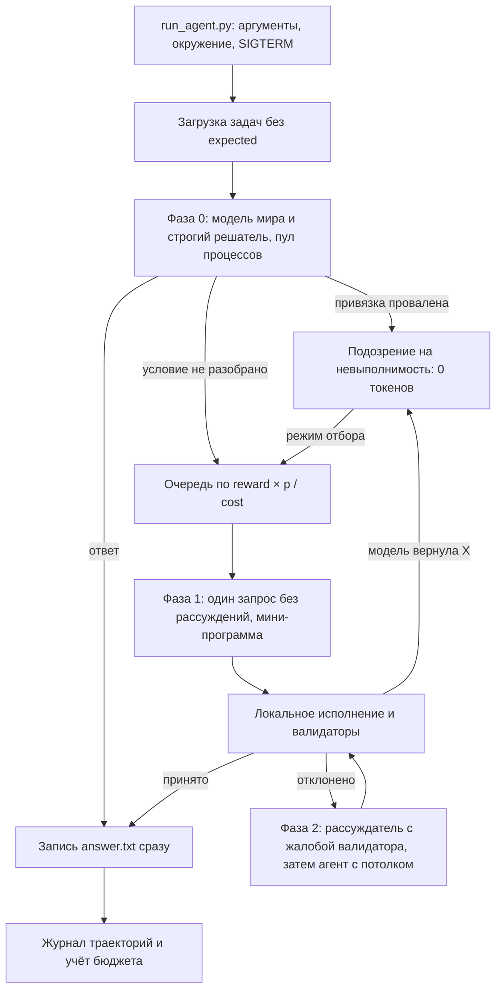

# openJiuwen Challenge 2026 — итоговая архитектура решения

Единый документ решения. Заменяет `IDEA.md`, `SOLUTION_IDEAS_RU.md` и `SOLUTION_IDEAS_RU_GPT.md`: всё, что из них принято, перенесено сюда; всё, что отвергнуто, перечислено в §20 с причиной. `PROJECT_ANALYSIS_RU.md` остаётся как учебный разбор постановки, но при расхождении верен этот файл.

Дата: 12 ноября 2026. Доступ к API организаторов действует до 20 ноября 23:59 МСК.

Рабочее название: **Grounded Compiler Cascade** — «компилируй, а не беседуй».

## 0. Решение на одной странице

1. **Фаза 0, ноль токенов.** Строгие детерминированные решатели проходят по всем задачам и сразу пишут ответы. Решатель отвечает, только если разобрал условие целиком; иначе отказывается.
2. **Фаза 1, около 50–150 выходных эквивалентов на задачу.** Для отказов фазы 0 модель без рассуждений одним запросом переводит условие в крошечную программу: арифметическую цепочку, один `SELECT`, правку нескольких строк. Считает и проверяет локальный код.
3. **Фаза 2, сотни и тысячи эквивалентов, жёсткий потолок.** Повтор с моделью-рассуждателем и жалобой валидатора; в крайнем случае ограниченный `ReActAgent` openJiuwen.
4. **Невыполнимость — это провал привязки к данным**, найденный бесплатно: сущности, колонки или значения из вопроса нет в данных. На такие задачи токены не тратятся.
5. **Ответ пишется на диск в момент получения.** Обрыв по бюджету, SIGTERM или падение не отнимают уже набранные баллы.
6. **Отборочный прогон — отдельный режим.** Обе задачи там выполнимы, поэтому вердикт «невыполнимо» в нём запрещён, а каждая задача проходит все уровни.

Ожидаемый расход на 100 задач — 3–10 тыс. из 100 тыс. эквивалентов. Это оценка, а не замер: живой прокси в этой работе не вызывался (§19).

### Что проверено при подготовке документа

| Проверка | Результат |
|---|---|
| Прочитаны регламент, журнал чата организаторов, все прежние документы, восемь примеров | Противоречия между документами сведены в §1 и §2 |
| Прототип решателей фазы 0 на восьми примерах (временные копии, `expected` сравнивался после ответа) | 6 из 6 ответов math, search, data_analysis совпали; оба coding-примера доведены до зелёных тестов перебором мутаций за 29 и 27 запусков тестов |
| Неоднозначность мутационного ремонта | В `coding_0007` тест `test_count_even` проходят три разные правки, одна из них неверна по смыслу (§7.4) |
| Исходники openJiuwen на теге `v0.1.19`: `Model`, `ModelClientConfig`, `ModelRequestConfig`, клиент OpenAI, экспорты и сигнатуры `Workflow`, `WorkflowComponent` | Уточнения в §12; два риска из прежних документов сняты, один добавлен |
| Каталог `task-dir` после прототипа | Не изменён, лишних файлов нет |

Не проверялось: живой прокси и его `usage`, поведение SDK при исполнении, скрытые тесты. Сборка образа и запуск в контейнере проверены только для каркаса шага P0-1 (см. «Границы этой работы» в §19). Содержимое `.env` не читалось.

### Метки источников

| Метка | Значение |
|---|---|
| **[Р]** | `Регламент соревнования.md` |
| **[Ч]** | Чат организаторов, `openjiuwen_agent_context_expanded.txt`, в основном обзор вопросов от 7 ноября |
| **[В9]** | Встреча 9 ноября в пересказе `IDEA.md`. Первоисточник — аудиозапись, в репозитории её нет |
| **[Пр]** | Восемь примеров в `task-dir` |
| **[SDK]** | Исходники `openJiuwen-ai/agent-core`, тег `v0.1.19`, прочитаны при подготовке |
| **[Т]** | Проверено прототипом при подготовке |
| **[Г]** | Оценка или гипотеза, требует замера |

## 1. Что изменилось относительно прежних документов

| Вопрос | Было | Принято | Основание |
|---|---|---|---|
| Путь к примерам | `task-dir/task-dir/` в `PROJECT_ANALYSIS_RU.md` и `README.md` | `task-dir/<task_id>/`, вложенности нет | Дерево файлов |
| `.env` в индексе Git | «Уже в индексе» | Не отслеживается, `.gitignore` его исключает | `git ls-files` |
| Скрытые повторы клиента `openai` | Риск: `max_retries=2` по умолчанию | В 0.1.19 клиент создаётся с `max_retries=0`, поле конфигурации в SDK не передаётся | [SDK] |
| Фабрика `init_model` | Не упоминалась | Не использовать: у неё `max_retries=3` и `verify_ssl=False` по умолчанию. Создавать `Model` явно | [SDK] |
| Таймаут запроса | Не задан | В SDK 360 с по умолчанию. Задавать свой: 60 с без рассуждений, 180 с с рассуждениями | [SDK] |
| Параллельность | 5 сессий | Старт с 3, подъём до 5 при отсутствии 429 | [Р] даёт 5, [В9] сообщает о лимите 3 на ключ |
| Агентный цикл как основной путь | Основа в анализе, запасной путь в идеях | Только последний уровень с потолком | Экономика, §3 |
| Собственный DSL планов | Стратегия 1 в `SOLUTION_IDEAS_RU_GPT.md` | Отвергнут: вместо него мини-программа на подмножестве Python и SQL | Общность при той же цене выхода |
| Строгий бюджетный инвариант с блокировками и сверкой по id | §2 обоих файлов идей | Один процесс `asyncio`, резерв до отправки, списание по `usage` | Превышение не штрафуется сверх остановки, ответы уже на диске |
| Отсутствие `BUDGET` | «Только локальные пути» | 100 000 по умолчанию, LLM работает | Иначе риск провалить отбор |
| Сводный файл `OUT` | «Если подтвердят» | Писать, если путь задан и доступен; никогда не падать из-за него | [Р] требует, [В9] говорит, что `OUT` не будет |
| Невыполнимая задача с бесплатным ответом | Не создавать файл | Писать ответ, если он вычислен за ноль токенов | Ошибка и пропуск дают одинаковый ноль, §9.2 |
| Обученная мета-политика, бандиты, рюкзак | Идеи 2 и 5 | Отложены; остаётся таблица стоимости с онлайн-поправкой | Данных нет, бюджет не связывает |

## 2. Правила и их следствия

| Правило | Источник | Следствие для архитектуры |
|---|---|---|
| 100 задач, четыре типа, `task_type`, `reward` и `check` видны сразу; `expected` в финале уберут | [Р], [Ч] | Тип не распознаём, а читаем. `check` задаёт формат ответа. `expected` не читается нигде в образе |
| Баллы случайны и не связаны со сложностью | [Р] | Порядок платных попыток — по `reward × p / cost`, а не по награде |
| Неверный ответ и пропуск дают ноль; за пропуск невыполнимой баллов нет | [Р], [Ч] | Детектор невыполнимости экономит токены, а не защищает от штрафа |
| Бюджет в выходных токенах, 10 входных = 1 выходной, рассуждения считаются выходом, кеш не учитывается | [Р] | Длинный вход и короткий выход. Рассуждения — только точечно |
| `BUDGET` в окружении, ориентир 100 000; прокси остаток не сообщает | [Ч] | Собственный учёт. В опубликованной команде `-e BUDGET` нет, поэтому нужен дефолт |
| При исчерпании прокси перестаёт отвечать, запуск завершается | [Р], [Ч] | Вся бесплатная работа — до первого вызова LLM. Каждый ответ сразу на диск |
| `answer.txt` рядом с `task.json`; для невыполнимой файл не создавать; для coding — `DONE` | [Ч], [Пр] | §13. Дубль в `workspace/` как страховка от иной трактовки «текущего каталога» |
| Детерминированное решение разрешено, «можно решить все, если получится» | [Ч] | Фаза 0 легитимна |
| openJiuwen обязателен; версию выбирает команда; AgentForge-harness разрешён | [Р], [Ч] | Конвейер, вызовы модели, инструменты и агент последнего уровня — на конструкциях SDK, §12 |
| Четыре модели, смена на любом вызове, цена токена одинакова | [Р] | Модель выбирается по точности и задержке. По умолчанию `-noreason` |
| Локальные нейросети запрещены, классические методы разрешены | [Р] | Никаких эмбеддингов. Поиск — точный разбор и SQL |
| Контейнер: root только на чтение, `/tmp` 2 ГБ, каталог задач на запись, `--cap-drop ALL`, `--pids-limit 512`, 1 час, сеть только до прокси | [Р] | §5 |
| Этапы: проверка безопасности образа с помощью LLM, сборка до 1000 с, отбор на двух выполнимых задачах, полный прогон | [Р] | Прозрачный код, песочница, режим отбора, §11.4 |
| При равенстве баллов побеждает меньший расход; считаются все токены прогона | [Р], [В9] | После баллов минимизируем токены. Остаток бюджета не «дожигаем» |
| Формулировки в финале будут другими, задачи внутри типа неоднородны, «подвохи точно будут»; скрытые тесты coding несколько шире видимых | [В9] | Строгие решатели отказываются при любом неразобранном слове. Coding чинится по смыслу, а не под один assert |
| Организаторы ожидают около 30% решённых задач; могут увеличить набор или урезать бюджет | [В9] | Эталонный агент у них — цикл с инструментами. Наш планировщик не должен зависеть от числа задач и размера бюджета |

## 3. Экономика

Стоимость вызова в выходных эквивалентах (далее ВЭ):

```text
cost = prompt_tokens / 10 + completion_tokens     # рассуждения входят в completion_tokens
```

| Путь | Вход, токены | Выход, токены | ВЭ на задачу | Задач на 100 тыс. ВЭ |
|---|---:|---:|---:|---:|
| Строгий решатель | 0 | 0 | 0 | без ограничений |
| Один запрос-перевод без рассуждений | 300–700 | 10–60 | 40–130 | около 1000 |
| Правка coding одним запросом без рассуждений | 500–900 | 40–150 | 90–240 | около 500 |
| Один запрос с рассуждениями | 400–900 | 600–3000 | 650–3100 | 30–150 |
| Агентный цикл, 5–8 шагов, схемы инструментов, растущая история | 10–25 тыс. | 500–1200 | 1500–3700 | 27–65 |

Все числа — оценки [Г]. Последняя строка воспроизводит ожидание организаторов «около 30%» [В9].

Измеренные размеры данных [Т]: вся база знаний `search_0005` — 2431 байт (около 700–800 токенов), `sales.csv` на 300 строк — 7641 байт (несколько тысяч токенов, так как цифры токенизируются мелко).

Выводы:

- **Бюджет перестаёт быть главным ограничением.** Сильные команды уложатся все. Место определят верность на переформулированных задачах и подвохах, затем суммарный расход.
- **Интерфейс вызова инструментов — самый дорогой.** Схемы раздувают каждый вход, JSON-аргументы и пояснения раздувают выход, история пересылается заново. Один простой запрос с коротким выходным форматом избегает всего этого.
- **Примеры в промпте почти бесплатны.** Пример на 60 токенов стоит 6 ВЭ и удерживает модель без рассуждений в формате.
- **Сырые данные в контекст не кладём.** Модели нужны схема и словарь значений, а не 300 строк.
- **Рассуждения — исключение.** Один вызов с рассуждениями стоит как 10–30 вызовов без них.

## 4. Архитектура



Четыре уровня решения одной задачи:

| Уровень | Что делает | Цена | Когда |
|---|---|---|---|
| T0 | Строгий разбор условия и локальное вычисление | 0 | Всегда, для всех задач |
| T1 | Один запрос без рассуждений переводит условие в мини-программу | 40–240 ВЭ | T0 отказался, привязка к данным есть или неизвестна |
| T2 | Тот же запрос модели-рассуждателю, с жалобой валидатора | до 1500 ВЭ | T1 отклонён валидаторами |
| T3 | `ReActAgent` openJiuwen с тремя локальными инструментами | до `min(3000, 3% BUDGET)` ВЭ | Данные не ложатся в модель мира или T2 не помог при высокой награде |

Порядок старта критичен:

1. Только стандартная библиотека: разбор аргументов, подготовка окружения, обработчик SIGTERM, загрузка задач.
2. Параллельно запускается «канарейка» — подпроцесс `python -c "import openjiuwen"` с таймаутом 120 с. Он показывает, импортируется ли SDK в этой среде.
3. Фаза 0 на стандартной библиотеке, ответы на диске.
4. Импорт openJiuwen в основном процессе, только если канарейка завершилась успешно. Далее фазы 1 и 2.
5. Если канарейка упала или зависла — деградированный режим: вызовы модели идут через пакет `openai` напрямую (он уже есть в образе как зависимость SDK), событие пишется в журнал.

Так отказ SDK при импорте не обнуляет результат фазы 0. Решатели фазы 0 те же самые функции, что зарегистрированы как инструменты openJiuwen и используются на уровнях T1–T3 как исполнители и валидаторы.

## 5. Контракт исполнения

### 5.1. Запуск

Команда организаторов [Р]:

```bash
timeout -k 1000s 1h docker run --rm --name "run-${TEAM}" \
  --network hack-net -e LLM_BASE_URL -e LLM_API_KEY \
  -v "$TASKS:/data/tasks:rw" \
  --read-only --tmpfs /tmp:rw,size=2g -e HOME=/tmp \
  --cap-drop ALL --security-opt no-new-privileges \
  --cpus 8 --memory 16g --pids-limit 512 \
  --workdir /app --entrypoint python \
  "hack:latest" /app/run_agent.py --tasks-dir /data/tasks
```

| Деталь | Требование к харнессу |
|---|---|
| `--entrypoint python /app/run_agent.py` | Файл обязан лежать в `/app`. `ENTRYPOINT` из Dockerfile не используется |
| Аргументы | `argparse.parse_known_args()`. Каталог задач: `--tasks-dir`, затем `--tasks`, затем позиционный аргумент, затем `TASKS` из окружения, затем `/data/tasks` |
| `--read-only` | До любых импортов: `os.chdir("/tmp/run")`, `TMPDIR`, `XDG_CACHE_HOME`, `MPLCONFIGDIR`, каталог логов — всё в `/tmp` |
| `--cap-drop ALL` | У root нет `CAP_DAC_OVERRIDE`: чужой каталог без прав на запись даст `PermissionError`. Ловить, писать в журнал, пробовать `workspace/` |
| `--pids-limit 512` | Пул тестов не больше 4 процессов, у каждого своя группа процессов |
| `--cpus 8` при «не более 4 ядер» в таблице | Проектировать под 4 |
| `timeout -k 1000s 1h` | Через час приходит SIGTERM. Свой дедлайн — 50 минут от старта. 1000 с после сигнала рабочим временем не считать |
| `-e BUDGET` отсутствует | `BUDGET` из окружения, иначе 100 000 |
| `docker build -t "hack:latest"` без контекста | Опечатка организаторов. Локально: `docker build -t hack:latest .` |
| Код возврата | Всегда 0. Каждая задача в своём `try/except` |

### 5.2. Обнаружение задач

Задача — непосредственный подкаталог каталога задач с читаемым `task.json`. `__MACOSX`, `.DS_Store` и файлы `._*` пропускаются. Идентификатор и тип берутся из полей, а не из имени каталога. Каталога `workspace/` может не быть (у math его нет [Пр]).

Загрузчик возвращает неизменяемую структуру:

```python
@dataclass(frozen=True)
class Task:
    task_id: str
    task_type: str            # math | search | data_analysis | coding | <unknown>
    instruction: str
    reward: float
    check: str | None         # exact_int | exact_str | unittest | None
    task_dir: Path            # answer.txt goes here
    workspace: Path | None    # data lives here
```

Поле `expected` отбрасывается при чтении и не попадает ни в структуру, ни в журнал. Неизвестный `task_type` не роняет запуск: такая задача идёт сразу на T1 с общим промптом. Битый JSON — задача пропускается с записью в журнал.

### 5.3. Сигналы и время

- SIGTERM и SIGINT выставляют флаг остановки: новые вызовы не начинаются, текущие отменяются, журнал сбрасывается. Ответы уже на диске.
- Единые монотонные часы от старта процесса. Новая попытка не начинается, если до внутреннего дедлайна меньше её таймаута плюс 10 с.
- Фаза 0 имеет собственный потолок 8 минут; при превышении оставшиеся задачи переходят в очередь T1.

## 6. Общие правила строгих решателей

1. **Срез служебного хвоста.** Конец условия одинаков во всех примерах: «Compute it with the bash tool…», «Use the file tools or bash…», «Use bash with python3…», «Work only inside the current directory…», «…echo 42 > answer.txt». Он срезается до разбора и до отправки в модель. `echo 42` — пример команды, а не ответ.
2. **Отказ при неполном разборе.** Решатель отвечает, только если каждое предложение условия после среза хвоста поглощено правилом. Любое неизвестное слово означает отказ и переход на T1. Неверный бесплатный ответ стоит баллов, отказ стоит около 60 ВЭ.
3. **Три исхода, а не два.**

```python
class Verdict(Enum):
    SOLVED = "solved"            # answer computed, evidence recorded
    UNPARSED = "unparsed"        # the solver did not understand the wording -> T1
    UNGROUNDED = "ungrounded"    # wording understood, required fact is absent -> suspected infeasible
```

   «Решатель не понял» и «решатель понял, но факта нет» — разные состояния. Первое ведёт к модели, второе — к подозрению на невыполнимость. Смешение этих состояний — главный источник ложных отказов.
4. **Данные задачи изолированы.** Никакого кеша между задачами: у Fjord Data штаб-квартира в Quito в `search_0001` и в Osaka в `search_0005` [Пр].
5. **Файл — истина, условие — заявление.** Если условие говорит «20 rows», а в файле иначе, считаем по файлу; расхождение пишем в журнал.

## 7. Решатели по типам

### 7.1. math

**T0.** Библиотека операций по предложениям. Из примеров [Пр]:

| Шаблон предложения | Действие |
|---|---|
| `A warehouse starts with N boxes.` | `s = N` |
| `Then the stock is split equally into K warehouses and it keeps one share (rounded down).` | `s //= K` |
| `Then the stock is doubled by merging with a sister warehouse.` | `s *= 2` |
| `It ships A boxes per day for D days.` | `s -= A * D` |
| `It receives K deliveries of M boxes each.` | `s += K * M` |
| `How many boxes does it have at the end?` | вернуть `s` |

Слова предметной области (warehouse, boxes, stock) параметризуются, чтобы «depot» и «crates» не ломали разбор. Библиотека пополняется шаблонами из собственного генератора (§17). Ожидаемое покрытие в финале низкое: текст свободный [В9]. Основная нагрузка этого типа — на T1.

Инварианты: остаток не уходит в минус, делитель не ноль, результат — целое.

**T1.** Модель пишет цепочку присваиваний на подмножестве Python. Она не считает, а только переводит.

```text
System: Translate the word problem into Python statements over the integer variable s.
Use only integers, + - * // % and parentheses. Round exactly where the text says.
If a needed quantity is missing or the question cannot be answered exactly, output X.
Output the statements on one line, separated by "; ". No comments.

Q: A depot starts with 500 crates. It ships 20 crates per day for 4 days. Then the stock is split
equally into 3 depots and it keeps one share (rounded down). How many crates does it have at the end?
A: s=500; s-=20*4; s//=3

Q: A shop starts with 90 jars. It sells some jars every day for 5 days. How many jars are left?
A: X

Q: <instruction without the boilerplate tail>
A:
```

Параметры: `-noreason`, `temperature=0`, `max_tokens=96`, `stop="\n"`.

Исполнение: разбор через `ast`, белый список узлов (`Assign`, `AugAssign`, `BinOp`, `UnaryOp`, `Constant` типа `int`, `Name` из разрешённого набора, из вызовов только `min`, `max`, `abs`), ни атрибутов, ни импортов, ни циклов. Показатель степени ограничен. Вычисление — обход дерева собственным интерпретатором, без `eval`.

Валидаторы:

- **Покрытие чисел.** Каждое число из условия встречается в программе; в программе нет чисел, которых нет в условии, кроме 0, 1, 2, 10, 100. Нарушение не отклоняет ответ, а отправляет на T2: лишние числа — вероятный подвох.
- **Инварианты** из T0.
- **Формат** по `check`.

### 7.2. data_analysis

**Модель мира.** CSV читается модулем `csv` и загружается в SQLite в памяти. Типы колонок выводятся по содержимому. Для колонок с малой мощностью собирается словарь значений, для числовых — минимум и максимум. Кодировка: UTF-8 с запасным вариантом `utf-8-sig`. Разделитель определяется `csv.Sniffer` с запасным вариантом «запятая».

**T0.** Слотовая грамматика вопроса:

| Слот | Формы |
|---|---|
| Агрегат | `how many units` → `SUM(units)`; `how many orders` → `COUNT(*)`; `total revenue` → `SUM(units*price)`; `average price` → `AVG(price)` |
| Фильтр по значению | литерал в кавычках сопоставляется со словарями колонок; имя колонки перед ним (`product 'widget'`) должно совпасть |
| Диапазон | `in months A through B inclusive` → `month BETWEEN A AND B`; `in month A` → `month = A` |

Из примеров подтверждена только первая строка каждого слота [Пр]. Остальные — заготовки под «похожую структуру», они включаются только после проверки на собственном генераторе.

Привязка:

| Наблюдение | Вердикт |
|---|---|
| Файла нет, он пуст или не читается | `UNGROUNDED` |
| Колонки из вопроса нет в заголовке | `UNGROUNDED` |
| Литерал фильтра отсутствует в словаре колонки | `UNGROUNDED`, но пишется ответ `0`, если агрегат — сумма или количество (§9.2) |
| Диапазон вне домена колонки (месяц 13) | `UNGROUNDED` |
| Литерал есть, но в диапазоне нет строк | `SOLVED`, ответ `0` |
| Литерал отличается регистром или пробелами | Нормализовать и считать; расхождение в журнал |

**T1.** Вход — схема, три строки, словари значений и вопрос. Выход — один `SELECT`.

```text
System: Write one SQLite SELECT that answers the question. Output only the SQL on one line.
If the question cannot be answered exactly from this table, output X.

Table sales(order_id INT, region TEXT, product TEXT, month INT, units INT, price INT)
region in {east, north, south, west}; product in {gadget, sprocket, widget}; month 1..12
Rows: (1,'south','gadget',1,22,95), (2,'east','sprocket',1,34,23), (3,'east','gadget',7,38,42)

Q: How many units of product 'gadget' were sold in month 7?
A: SELECT SUM(units) FROM sales WHERE product='gadget' AND month=7

Q: <question>
A:
```

Параметры: `max_tokens=120`, `stop="\n"`.

Исполнение: отдельное соединение, `set_authorizer` разрешает только `SQLITE_SELECT`, `SQLITE_READ` и `SQLITE_FUNCTION`; `set_progress_handler` обрывает запрос после заданного числа шагов; одна инструкция.

Валидаторы: результат — одна строка и одна колонка; все литералы запроса есть в словарях; все имена колонок есть в схеме; `NULL` у суммы по пустой выборке трактуется как `0`; целочисленный результат с дробной частью `.0` приводится к целому при `exact_int`.

### 7.3. search

**Модель мира.** Каждый файл `kb/*.md` разбирается в сущность: первая строка `# Имя`, далее строки `Ключ: Значение`. Тип сущности — префикс имени файла (`person`, `company`). Результат — таблицы SQLite по типам: `person(name, born, employer, mentor)`, `company(name, headquarters, founded)`; набор колонок берётся из встреченных ключей.

Связи выводятся автоматически: колонка считается ссылкой на тип T, если не менее 80% её значений — имена сущностей типа T. Так `person.employer → company.name`, `person.mentor → person.name`.

Доля файлов, разобранных в этот формат, пишется в журнал. Ниже 90% модель мира считается непригодной, задача идёт на T1 в режиме «фрагменты» (см. ниже).

**T0.** Связывание сущности и разбор цепочки отношений:

```text
NP    := ENTITY | NP "'s" REL | "the" REL "of" NP
Q     := "In which year was" NP "born?"                      -> born
       | "In which city is the headquarters of" NP "?"       -> headquarters
       | "In which year was" NP "founded?"                   -> founded
       | "Who is the mentor of" NP "?"                       -> mentor
       | ...
```

`ENTITY` — точное совпадение с именем сущности из базы этой задачи, самое длинное из возможных. `REL` — ключ из словаря синонимов (`employer`, `works for` → `employer`; `headquarters`, `based`, `located` → `headquarters`). Каждый шаг цепочки проверяется по типу: ключ должен существовать у типа текущей сущности, значение промежуточного шага должно быть именем сущности. Из примеров подтверждены первые две формы вопроса и цепочка `X's employer` [Т].

Привязка:

| Наблюдение | Вердикт |
|---|---|
| Сущности из вопроса нет в базе | `UNGROUNDED` |
| Имя совпало с несколькими сущностями (два файла с одним заголовком) | `UNGROUNDED` |
| У сущности нет запрошенного ключа | `UNGROUNDED` |
| Промежуточная ссылка ведёт на отсутствующую сущность | `UNGROUNDED` |
| Два файла дают одной сущности разные значения ключа | `UNGROUNDED` |
| В вопросе только имя или только фамилия, подходят несколько | `UNGROUNDED` |
| Почти совпадение (`Irina Smyth` против `Irina Smith`) | `UNGROUNDED`; значение ближайшей сущности пишется как бесплатный ответ (§9.2) |
| Цикл в цепочке ссылок | Не ошибка: цепочка конечна по длине вопроса |

Похожие имена — штатная ситуация: Irina Smith и Irina Haddad, Alice Smith и Alice Novak [Пр]. Нечёткий поиск по фамилии запрещён.

**T1.** Вход — схемы таблиц с выведенными связями, список имён сущностей (если их не больше 80) и вопрос. Выход — один `SELECT` с соединениями для многошаговых вопросов.

```text
Tables:
person(name, born, employer -> company.name, mentor -> person.name)
company(name, headquarters, founded)

Q: In which city is the headquarters of Sergei Garcia's employer?
A: SELECT c.headquarters FROM person p JOIN company c ON c.name=p.employer WHERE p.name='Sergei Garcia'
```

Параметры: `max_tokens=160`, `stop="\n"`. Исполнение и валидаторы те же, что для data_analysis. Дополнительно: ноль строк означает `UNGROUNDED`, несколько разных строк — отправку на T2.

**Режим «фрагменты».** Если база не ложится в `Ключ: Значение`: при размере до 6 тыс. токенов вся база отдаётся одним запросом с форматом ответа `ANSWER: <value>` или `X`; при большем размере — BM25 по файлам (собственная реализация на стандартной библиотеке, это классический метод) и 5 лучших фрагментов. Ответ принимается, только если он дословно встречается в переданном тексте.

### 7.4. coding

**Модель мира.** Копия `workspace/` в `/tmp`, AST `mylib.py`, AST файла тестов, результат запуска тестов. Оригинал не трогается до финальной записи. Хеш каждого файла, кроме `mylib.py`, сверяется до и после.

**Запуск тестов.** `python -B test_mylib.py -v` в копии, таймаут 10 с, своя группа процессов, очищенное окружение. Флаг `-I` использовать нельзя: он убирает каталог скрипта из `sys.path`, и `import mylib` падает [Т]. Результат — множество упавших тестов; падение импорта или синтаксическая ошибка — отдельный исход.

**T0, шаг 1: мутационный ремонт.** Для каждого упавшего теста перебираются одиночные правки исходника. Правка делается подстановкой в текст по позициям узлов AST, а не через `ast.unparse`, чтобы не менять форматирование остального файла.

| Приоритет | Класс правки | Примеры |
|---|---|---|
| 1 | Оператор сравнения | `<` ↔ `>`, `<=` ↔ `>=`, `<` ↔ `<=`, `==` ↔ `!=` |
| 1 | Составное присваивание | `+=` ↔ `-=`, `*=` ↔ `//=` |
| 1 | Имя встроенной функции | `sorted` ↔ `reversed`, `min` ↔ `max`, `any` ↔ `all` |
| 2 | Бинарный оператор | `+` ↔ `-`, `*` ↔ `//`, `//` ↔ `/` |
| 2 | Логика | `and` ↔ `or`, снятие `not` |
| 3 | Целая константа | `c ± 1`, `0` ↔ `1` |
| 3 | Границы среза | `[:n]` ↔ `[:n-1]`, `[:n+1]`, `[n:]` |
| 3 | Возвращаемое имя | `return a` ↔ `return b` среди локальных имён функции |

Правка принимается как кандидат, если целевой тест стал зелёным, а множество упавших тестов строго уменьшилось. На примерах: `coding_0003` — 29 запусков тестов, `coding_0007` — 27 [Т].

**T0, шаг 2: выбор среди кандидатов.** Прохождение видимого теста не доказывает верность. Реальный случай из `coding_0007` [Т]: тест `count_even([1, 2, 4, 6, 7]) == 3` проходят три правки строки `x % 2 == 1`:

| Правка | Результат на тесте | По смыслу |
|---|---|---|
| `== 1` → `== 0` | 3 | верно |
| `== 1` → `!= 1` | 3 | верно для целых |
| `% 2` → `% 3` | 3 (числа 1, 4, 7) | неверно |

Скрытые тесты шире видимых [В9], поэтому кандидаты сравниваются с оракулом:

1. **Библиотека эталонов по имени функции**: `total`, `maximum`, `minimum`, `average`, `reverse_words`, `count_even`, `count_odd`, `first_n`, `last_n` и очевидные соседи. Эталон — оракул для дифференциального тестирования на случайных входах из домена видимых тестов (непустые списки небольших целых, короткие строки), а не замена кода.
2. Принимается кандидат, совпавший с оракулом на всех входах. Среди нескольких совпавших — с меньшим приоритетом класса правки.
3. Если эталона для функции нет: единственный кандидат принимается; при нескольких выбор отдаётся модели одним запросом с ответом-индексом (один токен выхода).

**Состояние реализации (шаг P1-2, `src/solvers/coding.py`).** Библиотеки эталонов ещё нет (P2-2), поэтому выбор сделан без неё:

- Мутации перебираются только в функциях, достижимых из упавшего теста (по AST файла тестов и прямым вызовам внутри `mylib.py`). На примерах это 11 и 18 запусков тестов вместо 29 и 27.
- Кандидаты одного теста сравниваются **между собой**: каждый прогоняется в песочнице на одних и тех же случайных входах из домена видимых тестов, совпавшие по поведению объединяются в класс. Выбирается класс с меньшим приоритетом правки, при равенстве — больший по размеру. В `coding_0007` правки `== 0` и `!= 1` попадают в один класс, `% 3` — в другой и отбрасывается.
- Если классов больше одного, правка всё равно публикуется (видимые тесты зелёные), а в журнал траекторий пишется пометка `ambiguous`; выбор моделью по индексу и оракул подключаются на следующих шагах.
- Аудит функций (шаг 3) и сохранение «лучшей копии» при исчерпании потолка не реализованы: при неудаче ремонта решатель возвращает `UNPARSED` и ничего не публикует.

**T0, шаг 3: аудит остальных функций.** Ошибка может сидеть в функции, чей видимый тест проходит или отсутствует. Каждая функция с эталоном сверяется с ним на случайных входах. Расхождение чинится, только если ровно одна одиночная правка даёт полное совпадение с оракулом: это сильное свидетельство внесённой мутации. Иначе функция не трогается.

**T1.** Если мутации не помогли: один запрос без рассуждений. Вход — `mylib.py` с номерами строк, только упавшие тесты, сжатый вывод (имя теста, ожидалось, получено). Выход — только изменённые строки.

```text
System: Fix the bugs in mylib.py so that the tests pass. Fix the function, not the test case.
Output only changed lines as "<line number>|<new line>". No explanations.
```

Параметры: `max_tokens=200`. Правка применяется в копии, тесты перезапускаются. До двух попыток без рассуждений (во второй — с выводом упавшего теста), затем одна с рассуждениями.

Кандидату, в котором появились литералы из assert'ов, доверия нет: он отклоняется.

**Публикация.** Только после зелёного полного прогона в копии: `mylib.py` атомарно заменяется в `workspace/`, затем пишется `DONE`. `__pycache__` в `workspace/` не появляется, так как тесты там не запускались.

**Привязка:**

| Наблюдение | Вердикт |
|---|---|
| Нет `mylib.py` или файла тестов | `UNGROUNDED` |
| Тесты зелёные с самого начала | Выполнить аудит, записать `DONE` |
| Один и тот же вызов с разными ожиданиями в двух assert'ах | `UNGROUNDED` |
| Тест падает без обращения к `mylib` | `UNGROUNDED` |
| Синтаксическая ошибка в `mylib.py` | Пропустить мутации, сразу T1 |
| Тест зависает | Таймаут, убить группу процессов, считать тест упавшим |
| Цикл ремонта исчерпал потолок | Остановить. Лучшая копия (меньше всего упавших тестов, ничего не сломано) сохраняется вместе с `DONE` по политике §9.2: это бесплатно |

## 8. Валидаторы и эскалация

Каждый результат T1 проходит перед принятием:

| Валидатор | Проверка | При нарушении |
|---|---|---|
| Привязка | Все литералы и идентификаторы программы существуют в модели мира | `UNGROUNDED` |
| Тип | `exact_int` — целое; `exact_str` — один непустой скаляр | T2 |
| Покрытие чисел (math) | §7.1 | T2 |
| Одна строка (SQL) | Ровно одно значение | T2 |
| Тесты (coding) | Полный зелёный прогон и неизменность остальных файлов | Повтор, затем T2 |
| Формат выхода | Разбирается строго; пустой блок рассуждений `<think></think>` срезается | Один повтор с текстом ошибки |

Ответ модели `X` означает «невыполнимо по мнению модели». В полном прогоне это конец работы над задачей. В режиме отбора — переход на T2.

**T2.** Тот же промпт, модель с рассуждениями, в конец добавляется одна строка с жалобой валидатора («result has 3 rows, expected 1», «number 87 from the question is unused»). `max_tokens` 1200–1500. Перед включением T2 нужно знать, ограничивает ли `max_tokens` рассуждения (§19): оборванное рассуждение не даёт ответа, а токены сгорают.

**T3.** `ReActAgent` с инструментами `sql`, `read_file`, `run_tests`, не более 4 итераций, вывод инструмента не более 600 символов, потолок на задачу `min(3000, 3% BUDGET)` ВЭ. Включается для задач, чьи данные не легли в модель мира, либо при награде выше медианы после неудачи T2.

**Выбор вместо генерации.** Везде, где T0 оставил несколько кандидатов (две правки, два прочтения вопроса), модель выбирает по индексу. Ответ — один токен.

## 9. Невыполнимые задачи

### 9.1. Обнаружение

Сигналы перечислены в таблицах привязки §7. Они детерминированы и бесплатны. Определение организаторов: задача, которую нельзя точно решить при имеющихся данных [Ч]. Известен один пример: вопрос о том, чего нет в данных [В9]. Остальные сигналы — гипотезы, заложенные в собственный генератор (§17).

Сигналы, которые **не** означают невыполнимость:

- решатель не разобрал формулировку;
- модель ошиблась или вернула мусор;
- тест красный (это и есть задача);
- вызов прокси упал;
- число строк в файле не совпало с заявленным в условии.

### 9.2. Политика: несимметричный выигрыш

Неверный ответ и отсутствие ответа дают ноль, пропуск ничего не приносит. Отсюда:

- Обнаружение невыполнимости нужно, чтобы **перестать тратить токены**, а не чтобы скрыть уже вычисленный бесплатный ответ.
- Если определённое значение существует (сумма по пустому фильтру равна `0`, у ближайшей по написанию сущности есть значение), оно записывается. Если задача действительно невыполнима, ничего не потеряно; если выполнима — баллы сохранены.
- Если вычислить нечего — файл не создаётся, как просили организаторы.

Политика управляется одним флагом `ANSWER_WHEN_UNSURE` (по умолчанию включён). Если будет объявлен штраф за ответ на невыполнимую задачу, флаг выключается, и те же сигналы становятся списком пропусков. Это вопрос №1 организаторам (§19).

### 9.3. Приманка с высокой наградой

Награды случайны, поэтому часть невыполнимых задач получит максимальные баллы. Планировщик умножает награду на вероятность успеха, а у задач с проваленной привязкой она близка к нулю ещё до первого токена. Жадный по награде агент сжигает бюджет именно здесь.

## 10. Бюджет

### 10.1. Учёт

```python
class Ledger:
    budget: int            # BUDGET env, default 100_000
    margin: float = 0.05   # tokenizer and rounding of the proxy are unknown
    spent: float           # settled by usage
    reserved: float        # in-flight upper bounds
    unknown: float         # timeouts after send, kept at the reserved value

    def can_afford(self, upper: float) -> bool:
        return self.spent + self.reserved + self.unknown + upper <= self.budget * (1 - self.margin)
```

- Перед вызовом резервируется верхняя граница: `ceil(est_prompt_tokens / 10) + max_tokens`.
- После ответа резерв заменяется фактом: `prompt_tokens / 10 + completion_tokens`. В SDK `output_tokens` берётся из `completion_tokens`, `reasoning_tokens` извлекается отдельно как справочное поле [SDK].
- Если `usage` не пришёл — резерв остаётся списанным.
- Таймаут после отправки — резерв переходит в `unknown` и не возвращается.
- Харнесс — один процесс `asyncio`, счётчик меняется в одном цикле событий, блокировки не нужны.
- Размер входа оценивается как `len(text) / k`. Стартовое `k = 3.0`; после каждого ответа `k` поправляется по фактическому `prompt_tokens` скользящим средним.

Проверка соглашения о рассуждениях делается один раз на этапе разработки (§19). До неё для вызовов с рассуждениями действует консервативное правило: стоимость считается как `prompt/10 + completion + reasoning`, если `reasoning_tokens > completion_tokens`.

### 10.2. Оценщик стоимости и успеха

Это та часть, по которой названо соревнование. Она проста, потому что конвейер построен предсказуемым:

- **Верхняя граница** стоимости вызова известна до отправки по построению: размер входа и `max_tokens`.
- **Ожидаемая стоимость и вероятность успеха** — таблица по парам «тип задачи, уровень». Начальные значения — априорные оценки [Г], они заменяются замерами на собственном наборе и поправляются онлайн скользящим средним в ходе запуска.

| Тип | Уровень | Ожидаемая стоимость, ВЭ | Априорная вероятность успеха |
|---|---|---:|---:|
| math | T1 | 70 | 0,85 |
| data_analysis | T1 | 80 | 0,85 |
| search | T1 | 75 | 0,90 |
| coding | T1 | 160 | 0,75 |
| любой | T2 | 1200 | 0,50 от остатка |
| любой | T3 | 2500 | 0,30 от остатка |

- **Уточнение** — небольшая классическая регрессия по признакам: длина условия, число чисел в условии, размер данных, число упавших тестов, число переходов в вопросе. Включается, только если на отложенных семействах задач она точнее таблицы.

### 10.3. Планировщик

1. Фаза 0 по всем задачам, без затрат.
2. Очередь T1 сортируется по `reward × p / cost`, параллельность 3 с подъёмом до 5.
3. Очередь T2 и T3 — в том же порядке, с потолками на задачу.
4. Остановка: остаток бюджета меньше самого дешёвого полезного вызова, либо очередь пуста, либо внутренний дедлайн.

Жадный порядок по плотности, а не точный рюкзак: фактические стоимости становятся известны после вызова, а жадный порядок естественно перепланируется. Он же не зависит от числа задач и размера бюджета.

Баллы лексикографически важнее токенов. Поэтому T2 включается всегда, когда привязка к данным есть и T1 отклонён; ущерб ограничивают потолки, а не курс «токены за балл». На задачи с вердиктом `UNGROUNDED` в полном прогоне токены не тратятся вовсе.

### 10.4. Режим отбора

Отборочный прогон — две выполнимые задачи, решить нужно обе, бюджет неизвестен [Р]. Режим включается, когда задач не больше 5.

- Вердикт `UNGROUNDED` запрещён: обе задачи выполнимы по условию, значит ошибается наш разбор. Такая задача идёт на T1, затем T2, затем T3.
- Ответ T0 записывается сразу, затем перепроверяется независимым вызовом T1. При расхождении арбитр — T2. Ответ T0 заменяется, только если T1 и T2 совпали между собой против него.
- Экономических отказов нет.
- Цена страховки — 100–300 ВЭ на обе задачи.

### 10.5. Отказы прокси

| Событие | Действие |
|---|---|
| HTTP 429 | Параллельность вдвое, пауза с джиттером, до 2 повторов вызова |
| Таймаут | Резерв в `unknown`, один повтор, если задача стоит своей цены |
| Ошибки 5xx или обрыв соединения | Паузы 5, 15, 45 с; затем размыкатель на 2 минуты |
| Отказ при учтённом расходе выше 90% бюджета | Считать бюджет исчерпанным, прекратить вызовы |
| 401 или 403 | Прекратить вызовы, записать причину |

Размыкатель общий на все сессии, чтобы пять воркеров не умножали задержку и расход.

### 10.6. Состояние реализации (шаг P1-3, 12 ноября)

Сделано и покрыто тестами (`tests/test_policy.py`):

- **Политика §9.2.** Флаг `ANSWER_WHEN_UNSURE` (по умолчанию включён): значение, вычисленное бесплатно, пишется на диск при любом вердикте, кроме `SOLVED`. Сейчас это `0` для суммы по отсутствующему значению фильтра или диапазону вне домена (T0 и T1), значение ближайшей по написанию сущности в search, частично починенный `mylib.py` с `DONE` в coding. При выключенном флаге эти же случаи остаются без `answer.txt`.
- **Токены на `UNGROUNDED` не тратятся** в полном прогоне: на T1 уходят только задачи с вердиктом `UNPARSED`.
- **Порядок платных попыток** — `reward × p / cost` по таблице §10.2 с онлайн-поправкой стоимости (`src/core/scheduler.py`).
- **Режим отбора** (задач не больше 5): `UNGROUNDED` от T0 ведёт на T1; ответ T0 пишется сразу и независимо перепроверяется вызовом T1; на ответ модели `X` и на провал привязки в T1 делается второй вызов с указанием, что задача выполнима. Живой прогон на двух примерах: оба ответа T0 подтверждены, страховка стоила 106,8 ВЭ.
- **Отказы прокси §10.5** (`ProxyGuard`, общий на все сессии): 429 — параллельность вдвое, пауза с джиттером, до двух повторов; после десяти успехов подряд параллельность растёт на единицу до `LLM_CONCURRENCY`; 5xx и обрывы — паузы 5, 15, 45 с, затем размыкатель на 2 минуты, во время которого остальные вызовы ждут либо отказываются, если ожидание не помещается до внутреннего дедлайна; таймаут — резерв в `unknown` и один повтор; любой отказ при учтённом расходе выше 90% бюджета — вызовы прекращаются; 401 и 403 — вызовы прекращаются. Добавлено по результатам пробы: отказ TCP-соединения — до трёх повторов без списания.

Отступления и то, что не сделано:

- **Арбитра T2 нет.** При расхождении T0 и T1 в режиме отбора остаётся ответ T0, расхождение пишется в журнал. Правило «заменять, если T1 и T2 совпали против T0» включится вместе с T2 (P2-1). Для coding перепроверка сейчас — второй прогон T1 поверх уже починенной библиотеки, то есть только повторный запуск тестов.
- **Стартовая параллельность — 3**, это же подтверждённый лимит прокси; подъём до 5 возможен только при `LLM_CONCURRENCY=5`.
- **Очереди T2 и T3** отсутствуют; условие остановки «остаток меньше самого дешёвого полезного вызова» выполняется отказом резерва в учёте, отдельной проверки нет.
- **Награда ложно отброшенных задач не измерена**: для этого нужны пакеты с невыполнимыми задачами из генератора (P1-1). Критерий готовности шага P1-3 по этому пункту не закрыт.

## 11. Параллельность

- Один процесс, один цикл событий `asyncio`.
- Вызовы модели: `asyncio.Semaphore`, стартовое значение 3, максимум 5, переменная `LLM_CONCURRENCY`.
- Тесты и мутационный ремонт: 4 одновременных запуска. В реализации это `ThreadPoolExecutor` на 4 потока, а не `ProcessPoolExecutor`: вся работа идёт в подпроцессах песочницы, потоки только ждут их, и лишние процессы не расходуют `--pids-limit`. Запуск теста на Windows занял около 0,25 с [Т]; в Linux-контейнере ожидается быстрее.
- Одна задача — один писатель. Параллельных попыток одной задачи нет: пока связывают токены, они их только умножают.

## 12. Интеграция с openJiuwen

Зафиксирована версия `0.1.19` (`pyproject.toml`, `uv.lock`). Проверено по исходникам тега [SDK]:

| Конструкция | Факт | Использование |
|---|---|---|
| `Model(model_client_config, model_config)` | Порядок позиционных аргументов именно такой; передавать по именам | Все вызовы модели |
| `await model.invoke(messages, *, temperature, max_tokens, stop, model, timeout, **kwargs)` | Метод называется `invoke` и асинхронный; `model=` позволяет менять модель на каждом вызове; `stop` — одна строка | Один экземпляр `Model`, модель и лимиты на вызов |
| `ModelClientConfig(client_provider, api_key, api_base, timeout, ...)` | `timeout` по умолчанию 360 с; `max_retries` в клиент не передаётся; клиент `AsyncOpenAI` создаётся с `max_retries=0` | `client_provider="OpenAI"`, свой `timeout` |
| `ModelRequestConfig(model=..., temperature, max_tokens, stop, reasoning)` | Дополнительные поля разрешены | Значения по умолчанию |
| `AssistantMessage.usage_metadata` | `input_tokens = prompt_tokens`, `output_tokens = completion_tokens`, `reasoning_tokens` отдельно | Списание в учёте |
| `init_model(...)` | `max_retries=3`, `verify_ssl=False` по умолчанию | **Не использовать** |
| Логика рассуждений в клиенте | `resolve_reasoning_plan` может сам добавить в запрос управляющие поля рассуждений по имени модели и провайдера | Проверить по журналу SDK, что для моделей `qwen*` ничего не добавляется (§19) |
| `Workflow`, `WorkflowCard`, `Start`, `End`, `BranchComponent`, `WorkflowComponent`, `LLMComponent`, `ToolComponent` | Экспортируются из `openjiuwen.core.workflow` | Конвейер одной задачи |
| `Workflow.add_workflow_comp(comp_id, comp, *, inputs_schema, outputs_schema, max_retries=0, timeout=-1.0, ...)`, `set_start_comp`, `set_end_comp`, `add_connection`, `add_conditional_connection` | Сигнатуры прочитаны | Сборка графа |
| `WorkflowComponent.invoke(self, inputs, session, context)` | Точка расширения для своих компонентов | Компоненты `Solve`, `Translate`, `Execute`, `Validate`, `Publish` |
| `Runner.callback_framework`, события `LLM_INVOKE_INPUT`/`OUTPUT` | `Model` оборачивает вызовы клиента событиями | Второй, независимый счётчик вызовов для сверки с учётом |

Не проверено исполнением: импорт SDK в контейнере без сети и с root только на чтение, время холодного импорта, поведение `Workflow` и `ReActAgent`, обращение к `tiktoken` или `transformers` на пути вызова. Всё это закрывает первый же прогон дымового теста (§16).

Раскладка ответственности:

| Часть | Конструкция openJiuwen | Файл |
|---|---|---|
| Вызов модели с лимитами и чтением `usage` | `Model`, `ModelClientConfig`, `ModelRequestConfig` | `src/foundation/llm.py` |
| Локальные инструменты `sql`, `read_file`, `run_tests` и решатели | декоратор `tool` из `openjiuwen.core.foundation.tool` | `src/foundation/tools.py` |
| Конвейер задачи T0 → T1 → валидаторы → T2 | `Workflow` со своими `WorkflowComponent` | `src/core/agent.py` |
| Агент последнего уровня | `ReActAgent`, `Runner` | `src/core/agent.py` |
| Учёт, планировщик, запись, песочница | обычный Python | `src/core/*` |

`LLMComponent` не используется для T1: неизвестно, сколько скрытого входа он добавляет. Модель вызывается из собственного компонента через `Model.invoke`, где вход контролируется побайтно.

Правило устойчивости: исключение внутри конструкции SDK не должно стоить задачи. Каждый компонент — тонкая обёртка над обычной функцией; при ошибке графа та же последовательность функций вызывается напрямую.

## 13. Запись ответов

| Правило | Обоснование |
|---|---|
| `answer.txt` рядом с `task.json` | [Ч] |
| Дубль в `workspace/answer.txt`, если каталог существует | Условие говорит «в текущем каталоге», эталонный агент работал, вероятно, в `workspace/`. Дубль безвреден |
| Содержимое — значение и перевод строки | Ровно то, что даёт `echo 42 > answer.txt` |
| `exact_int` — десятичное целое без пробелов, разделителей и `.0` | Формат по `check` |
| `exact_str` — значение в написании источника, без кавычек и точки | `Osaka`, а не `osaka` |
| coding — `DONE`, и только после замены `mylib.py` | Маркер последним |
| Атомарность: временный файл в том же каталоге, `flush`, `os.fsync`, `os.replace` | Переименование атомарно только в пределах одной файловой системы; `/tmp` для этого не годится |
| Запись сразу после решения | Обрыв ничего не отнимает |
| Сводный файл | Если задан `OUT` или `--out`: каталог → `<OUT>/answers.json`, иначе файл. JSON `{task_id: answer}`, перезаписывается атомарно после каждого ответа. Ошибка записи только журналируется |
| Существующий `answer.txt` | Перезаписывается нашим ответом. Не удаляется, если ответа нет |
| `PermissionError` | Журнал, попытка записать в `workspace/`, продолжение работы |

## 14. Безопасность

Первый этап оценки — проверка образа с помощью LLM [Р]. Код должен быть очевидно безопасным.

- Подпроцессы получают очищенное окружение: без `LLM_API_KEY`, `LLM_BASE_URL`, `BUDGET`. Только `PATH`, `HOME=/tmp`, `PYTHONDONTWRITEBYTECODE=1`.
- Рабочий каталог подпроцесса — копия в `/tmp`. Таймаут, своя группа процессов, `resource.setrlimit` на CPU, память и число процессов. Никакого `shell=True`.
- Программы от модели не исполняются через `eval` или `exec`: арифметика — собственным обходом AST, SQL — в SQLite с авторизатором.
- Правка coding от модели — это текст файла в копии; исполняется он только запуском тестов в песочнице.
- Проверка путей: разрешение симлинков и запрет выхода за каталог задачи.
- Содержимое файлов задач — данные. Текст, похожий на инструкции, в промпт не попадает: T1 видит схему и словари, а не содержимое.
- Единственный сетевой адрес — `LLM_BASE_URL`. Никаких загрузок при запуске, `HF_HUB_OFFLINE=1`, `TRANSFORMERS_OFFLINE=1`.
- Ключи не пишутся в журнал. В репозитории ключей нет.
- В README — раздел «Security model» с этим списком.

## 15. Критические случаи

### 15.1. Инфраструктура

| Случай | Что произойдёт без защиты | Защита |
|---|---|---|
| Импорт SDK пишет в рабочий каталог или идёт в сеть | Падение или зависание до первого ответа | `chdir` в `/tmp` до импортов, канарейка, фаза 0 до импорта |
| `BUDGET` не передан | Отключение LLM и провал отбора | Дефолт 100 000 |
| Бюджет отбора очень мал | Прокси замолчит на первой задаче | Фаза 0 первой; T1 дешёвый; порядок по цене |
| Неизвестные аргументы командной строки | `argparse` завершит процесс | `parse_known_args` |
| Нет прав на запись в каталог задачи | Ответ потерян | Запасной путь, журнал |
| SIGTERM через час | Потеря незаписанного | Запись сразу; дедлайн 50 минут |
| Прокси молчит не из-за бюджета | Преждевременная остановка | Размыкатель с повторной проверкой, пока учёт ниже 90% |
| Все пять сессий получают 429 | Лавина повторов | Общий размыкатель, снижение параллельности |
| `usage` не пришёл | Учёт занижен | Резерв остаётся списанным |
| Каталог задач содержит мусор (`__MACOSX`, `._*`) | Падение загрузчика | Задача — только каталог с читаемым `task.json` |
| Сотни задач вместо ста | Фаза 0 не успевает | Потолок времени фазы 0, очередь по плотности |
| Python судьи отличается от Python образа | Зелёные у нас тесты красные у судьи | Правки без новых конструкций языка: меняются только токены существующего кода |

### 15.2. Подвохи в задачах

| Подвох | Защита |
|---|---|
| Иная формулировка, новый сюжет в math | T0 отказывается; T1 переводит смысл |
| Условие заявляет одно число строк, в файле другое | Файл — истина |
| Огромный CSV или база знаний | Данные не попадают в контекст |
| Текст в данных, похожий на инструкции | Данные разбираются, а не интерпретируются |
| Похожие имена, шум регистра и пробелов | Точное связывание по нормализованным именам; неоднозначность — сигнал |
| Лишние числа в тексте math | Проверка покрытия чисел отправляет на T2 |
| Округление вверх, порядок операций | Примеры в промпте; вычисление локальное и точное |
| Видимый тест проходит, функция неверна | Оракул и дифференциальное тестирование |
| Ошибка в функции без видимого теста | Аудит всех функций по эталонам |
| Зависающие или размножающие процессы тесты | Таймаут, убийство группы, лимит процессов |
| `mylib.py` с синтаксической ошибкой | Сразу T1 |
| Высокая награда на невыполнимой задаче | Привязка до любых трат |
| Простая задача в длинной истории | Цена зависит от размера выхода, а не истории |
| Заранее лежащий `answer.txt` | Перезапись своим результатом |
| `158.0` вместо `158` | Формат по `check` |
| Строка-число при `exact_str` (`1983`) | Значение пишется как в источнике, без приведения типа |
| Пустая выборка | `0` для суммы и количества; для среднего — `UNGROUNDED` |
| Два одинаковых имени сущности в базе | `UNGROUNDED` |
| Значение ссылки с пробелом в конце или другим регистром | Нормализация при связывании, оригинал в ответе |

### 15.3. Модель

| Случай | Защита |
|---|---|
| Модель без рассуждений ломает формат | Примеры, `stop`, строгий разбор, один повтор с ошибкой, затем T2 |
| Пустой блок `<think></think>` или `reasoning_content` у модели без рассуждений | Срез перед разбором |
| Рассуждение съедает весь `max_tokens`, ответ пуст | Лимит T2 подбирается по замеру; пустой ответ — не повод повторять с тем же лимитом |
| Модель «решает» невыполнимую задачу | Валидатор привязки отклоняет программу с несуществующими литералами |
| Модель возвращает `X` на выполнимой задаче | В полном прогоне теряется одна задача; в режиме отбора — эскалация. Доля таких случаев меряется на генераторе |
| SQL с несколькими инструкциями или записью | Авторизатор SQLite, одна инструкция |
| Правка coding меняет тесты | Меняются только строки `mylib.py`; хеши остальных файлов сверяются |

## 16. Образ и репозиторий

Изменения в `Dockerfile`:

```dockerfile
ENV PATH="/app/.venv/bin:$PATH" \
    PYTHONDONTWRITEBYTECODE=1 PYTHONUNBUFFERED=1 HOME=/tmp \
    TMPDIR=/tmp XDG_CACHE_HOME=/tmp/.cache MPLCONFIGDIR=/tmp/.mpl \
    HF_HUB_OFFLINE=1 TRANSFORMERS_OFFLINE=1
```

- `UV_COMPILE_BYTECODE=1` уже включён: байткод скомпилирован при сборке, что важно для файловой системы только на чтение.
- Данные пакета (таблица стоимости, словари синонимов, эталоны функций) лежат внутри `src/` и попадают в wheel. Проверять их наличие нужно в собранном образе.
- `.dockerignore` пропускает только нужное; `.env`, задачи и документы в контекст не попадают.

Раскладка:

```text
run_agent.py                 # thin entry point -> src.cli.main()
src/
├── cli.py                   # args, env preparation, signals, exit code 0
├── config.py                # BUDGET, concurrency, caps, flags
├── core/
│   ├── tasks.py             # Task, loader, boilerplate stripping
│   ├── budget.py            # Ledger, cost table, online calibration
│   ├── scheduler.py         # phases, density ordering, qualification mode
│   ├── runner.py            # asyncio orchestration, deadlines, circuit breaker
│   ├── agent.py             # per-task Workflow, T3 ReActAgent
│   ├── results.py           # atomic answer.txt, OUT aggregate, trajectory log
│   └── sandbox.py           # subprocess runner, rlimits, clean env
├── foundation/
│   ├── llm.py               # Model wrapper, usage normalisation, fallback client
│   └── tools.py             # openJiuwen tool registrations
├── solvers/
│   ├── math.py              # sentence grammar, safe evaluator
│   ├── data.py              # CSV -> SQLite, slot grammar, SQL sandbox
│   ├── search.py            # KB -> SQLite, entity linking, path grammar
│   └── coding.py            # mutation repair, oracle library, patch applier
└── prompts/                 # few-shot prompt texts per task type
scripts/
├── gen_tasks.py             # training set generator, dev only
├── check.py                 # offline judge, dev only
├── probe_proxy.py           # proxy contract probe, dev only
└── smoke.sh                 # exact organisers' docker command on samples
tests/
trajectories/                # collected runs, JSONL
```

**Дымовой тест `scripts/smoke.sh`** запускается на каждом изменении:

1. `docker build -t hack:latest .` — время меньше 1000 с, размер меньше 4 ГБ.
2. Копия примеров без `expected`.
3. Точная команда организаторов с `--network none` и без `LLM_*`: харнесс не падает, фаза 0 решает примеры.
4. Тот же запуск с сетью, ключом и принудительно выключенной фазой 0: проверяется путь через модель.
5. Проверка снаружи контейнера: ответы на месте, `mylib.py` исправлен, тесты не изменены.
6. `docker kill --signal TERM` в середине прогона: уже записанные ответы сохранены.

Состояние репозитория, требующее внимания до сдачи:

- `README.md` переписан под требования регламента 13 ноября (§18.1).
- `openjiuwen_agent_context_expanded.txt` добавлен в индекс. В нём имена участников чата и коды доступа к видеовстречам. Для публичного репозитория его стоит убрать из индекса.
- `task-dir/` не отслеживается; решить, нужен ли он в репозитории как данные для дымового теста.

## 17. Тренировочный набор и эксперименты

Официального тренировочного набора нет [Р], [Ч]. Генератор — часть решения.

**`scripts/gen_tasks.py`:**

- четыре генератора, воспроизводящие структуру примеров, с ручками: длина цепочки операций, число переходов, число строк, число ошибок;
- для каждого типа несколько шаблонов формулировок и перефразировки, сделанные моделью на этапе разработки и проверенные человеком;
- невыполнимые варианты на каждый сигнал §7 и парные к ним выполнимые (продукт есть, но строк в диапазоне нет; город указан в другом файле);
- варианты подвохов на каждую строку §15.2;
- случайные награды 1–5, не связанные со сложностью;
- пакеты по 100 задач в той же раскладке каталогов; эталоны и параметры генерации хранятся вне дерева, доступного харнессу.

**`scripts/check.py`:** судья по `exact_int`, `exact_str`, `unittest`; для coding — со скрытыми дополнительными assert'ами.

**Эксперименты, закрывающие открытые решения:**

| Вопрос | Эксперимент |
|---|---|
| `qwen3.8-27b-noreason` или `qwen3.6-35b-a3b-noreason` для T1 | Точность и задержка на 200 задачах каждого типа |
| Учитывает ли прокси `stop`, `max_tokens`; входят ли рассуждения в `completion_tokens` и в `max_tokens` | `scripts/probe_proxy.py`: по одному вызову на каждую из четырёх моделей |
| Как округляется вход при пересчёте 10:1 | Сверка учёта со счётчиком в личном кабинете после известной последовательности вызовов |
| Сколько T0 отказывается и сколько ошибается на перефразировках | Доля отказов и доля неверных уверенных ответов по типам |
| Доля ложных `UNGROUNDED` | Суммарная награда выполнимых задач, помеченных невыполнимыми, на пакетах с 15–25% невыполнимых |
| Проходит ли мутационный ремонт скрытые тесты | Судья со скрытыми assert'ами, с оракулом и без него |
| Пакетирование: 5–8 однотипных вопросов в одном запросе | Точность и цена против одиночных вызовов; включать только без потери точности |
| SQL или выражение пути для многошагового поиска | Точность и длина выхода на сгенерированных базах |

**Проверки, ловящие ошибки общего состояния:**

- 28 неупорядоченных пар из восьми примеров как имитация отбора: доля пар с двумя верными ответами должна быть 100%.
- Парные возмущения: прибавить единицу к `units` подходящей строки — ответ растёт на один; той же правке неподходящей строки ответ не меняется. Изменить штаб-квартиру посторонней компании — ответ прежний; компании-работодателя — ответ меняется.

**Метрики:** сумма баллов на пакет; расход в ВЭ; доля задач, закрытых за ноль токенов; ошибки по типам; награда ложно отброшенных задач; время до последней записи.

**Траектории.** JSONL, одна запись на вызов и на шаг:

```json
{"run": "…", "task_id": "…", "task_type": "search", "reward": 2, "tier": "T1", "model": "…",
 "est_cost": 75, "prompt_tokens": 412, "completion_tokens": 31, "reasoning_tokens": 0,
 "cost": 72.2, "latency_s": 1.8, "validators": {"grounding": true, "single_row": true},
 "verdict": "solved", "reason": null}
```

В соревновательном прогоне журнал пишется в `/tmp`. Прогоны на собственном наборе сохраняются в `trajectories/` в репозитории; `expected`, ключи и заголовки авторизации в журнал не попадают.

### 17.1. Состояние реализации и замеры (шаги P1-1, P2-1, P2-2; 12–13 ноября)

**Сделано.**

- `scripts/gen_tasks.py`: четыре генератора по структуре примеров; семейства — формулировка организаторов, перефразировки (написаны вручную, моделью не генерировались), подвохи (лишние числа, неверно заявленное число строк, ошибка в функции без видимого теста, ошибка вне класса одиночных правок) и невыполнимые варианты с парными выполнимыми. Награды случайные 1–5. Эталоны (`expected`, `feasible`, `family`, скрытые тесты coding) пишутся в отдельный каталог `--ref`.
- `scripts/check.py`: судья с запуском скрытых тестов coding, разбивкой по типам и семействам, счётчиками неверных ответов, пропусков и ответов на невыполнимые задачи.
- **Оракул coding** (`src/solvers/oracles.py`): 13 эталонов по имени функции. Среди кандидатов правки побеждает совпавший с эталоном на всех случайных входах; после ремонта каждая функция с эталоном сверяется с ним (аудит). Отступление от §7.4: правка аудита принимается, если **хотя бы одна** одиночная правка даёт полное совпадение с эталоном и все видимые тесты остаются зелёными (а не «ровно одна»): `== 0 → != 0` и `0 → 1` обе верны и обе совпадают с эталоном. Функция, чей видимый тест противоречит эталону, не трогается.
- **T2** (`Tier1` с `reasoning=True`): модель `qwen3.8-27b`, одна попытка, жалоба валидатора в системном сообщении, `max_tokens=1400`, без `stop` (ответ модели с рассуждениями начинается с пустых строк).
- **Арбитр режима отбора**: ответ T0 заменяется, только если T1 и T2 независимо дали один и тот же другой ответ.
- **T3** (`src/core/react.py`, `src/foundation/tools.py`): `ReActAgent` SDK 0.1.19, не более 4 итераций, инструменты `read_file`, `sql`, `run_tests`, `replace_lines` с выводом до 600 символов, потолок на задачу `min(3000, 3% BUDGET)`, каждый вызов модели резервируется и списывается в общем учёте. Запускается для нерешённых задач с наградой не ниже медианы. Проверено исполнением: агент не добавляет скрытых промптов — в запросе системное сообщение, вопрос и схемы инструментов.

**Замеры.** Расход — по собственному учёту харнесса.

| Замер | Результат |
|---|---|
| Только T0, пакет 200 задач (seed 1), без оракула | 78 из 166 выполнимых; в math, data_analysis, search ни одного неверного ответа; coding «ошибка без видимого теста» — 0 из 11 на скрытых тестах |
| То же с оракулом и аудитом | «ошибка без видимого теста» — 11 из 11; всего 89 из 166 |
| Полный конвейер, пакет 100 задач (seed 2), `BUDGET=11000`, до настройки | 81 из 84, награда 244 из 252, неверных 0. T1: 36 задач за 1882 ВЭ. T2: 9 задач за 7844 ВЭ |
| Тот же пакет после настройки, `BUDGET=3500` | 84 из 84, награда 252 из 252, неверных 0; всего 1938 ВЭ, T2 не понадобился |
| Свежий пакет 80 задач (seed 3), `BUDGET=1650` | 47 из 65: бюджет прогона кончился, 18 задач не получили ни одного вызова T1; среди задач, дошедших до модели, ошибок модели нет. Одна задача coding с частичным ремонтом осталась с красными тестами |
| T2 на двух примерах | Оба решены за 223 и 108 ВЭ |
| T3 на трёх примерах | search и data_analysis решены за 304 и 283 ВЭ (по два вызова); coding упёрся в 4 итерации (731 ВЭ), после чего исходник и вывод тестов стали передаваться в первом запросе — повторно вживую не проверено |

**Что показал первый полный прогон и что изменено.**

- T2 дорог: 560–950 ВЭ на задачу math, 1436 ВЭ на coding (модель израсходовала весь лимит на рассуждение и не выдала правку). Априорная оценка 1200 ВЭ в §10.2 для math завышена, для coding занижена.
- Пять из девяти обращений к T2 вызвал валидатор покрытия чисел, и во всех пяти T2 повторил ответ T1. Теперь при сомнении сначала делается второй вызов T1 с указанием, что именно выглядит странно; T2 включается, только если два ответа T1 разошлись. Идиома округления вверх `(s + k - 1) // k` больше не считается «придуманным числом».
- Два обращения к T2 пришлись на невыполнимые задачи coding с противоречивыми assert'ами вида `6 + 1`: детектор сравнивал только литералы. Теперь сравниваются и выражения.
- Модель трижды ответила `X` на выполнимые перефразированные вопросы search (потеряно 8 баллов из 252 — это и есть измеренная награда ложно отброшенных задач на этом пакете). Теперь `X` не принимается с первого раза, если вопрос называет сущность или значение, которые есть в данных: делается второй вызов с указанием, что задача выполнима. В промпт search добавлен второй пример.
- Coding после отказа T1 идёт сразу на T3, минуя T2.

**Не сделано и не измерено.**

- Свежий пакет не пройден целиком (лимит на живые вызовы этого шага исчерпан), поэтому точность после настройки на независимых данных подтверждена только частично. Настройка делалась по пакету seed 2 — результат 84 из 84 на нём завышен.
- Сравнение `qwen3.8-27b-noreason` и `qwen3.6-35b-a3b-noreason`, пакетирование вопросов, регрессия для оценки стоимости, проверки «28 пар» и парные возмущения на генераторе — не проводились.
- T3 в составе полного прогона не срабатывал: при `BUDGET` ниже ~22 тыс. его потолок меньше верхней границы одного вызова. Обёртки конвейера в `Workflow` нет: единственная агентная конструкция SDK в решении — `ReActAgent`, вызовы модели идут через `Model`.
- Перефразировки генератора написаны одним автором и однотипны; реальные формулировки финала могут отличаться сильнее.

## 18. План работ

До закрытия доступа к API — 20 ноября. Каждый шаг либо страхует отбор, либо добавляет баллы на подвохах, либо убирает токены.

| Шаг | Что сделать | Готово, когда |
|---|---|---|
| **P0-1. Контракт** | `run_agent.py`, CLI, загрузчик без `expected`, запись ответов, сигналы, песочница, `smoke.sh` | Точная команда организаторов без сети отрабатывает на примерах без падения; прерывание сохраняет записанное |
| **P0-2. Проба прокси** | `probe_proxy.py`: формат `usage`, рассуждения, `stop`, `max_tokens`, лимит параллельности, задержки четырёх моделей | Заполнена таблица §19; выбран режим учёта |
| **P0-3. T1 для четырёх типов** | Обёртка `Model`, учёт, промпты, исполнители, валидаторы | Примеры решаются через модель при выключенной фазе 0; расход на задачу измерен. Это страховой полис |
| **P1-1. Генератор и судья** | `gen_tasks.py`, `check.py`, пакеты по 100 задач | Выбрана модель T1; известны точность и расход по типам |
| **P1-2. T0** | Сначала search и coding (наибольшее покрытие), затем data_analysis, затем math | 8 из 8 примеров за ноль токенов; на перефразировках нет уверенных неверных ответов |
| **P1-3. Привязка и политика невыполнимости** | Вердикты, флаг `ANSWER_WHEN_UNSURE`, режим отбора | Измерена награда ложно отброшенных задач |
| **P1-4. README и траектории** | Сборка и запуск, способ оценки расхода, поиск невыполнимых, траектории, модель безопасности | Покрыты все пункты регламента |
| **P2-1. T2 и T3** | Рассуждатель с жалобой, агент с потолком, планировщик по плотности | Прирост баллов на пакетах с подвохами при том же бюджете |
| **P2-2. Оракул coding** | Библиотека эталонов, дифференциальное тестирование, аудит функций | Скрытые assert'ы судьи проходят чаще, чем без оракула |
| **P2-3. Репетиция сдачи** | Чистый клон последнего коммита, сборка с пустым кешем, полный пакет под лимитами, доступ жюри `promsoft` и `madrugado` | Образ меньше 4 ГБ, сборка меньше 1000 с, репозиторий меньше 100 МБ |

P0-3 делается раньше T0 намеренно: один только T1 уже решает большинство задач заметно дешевле 10 тыс. ВЭ и проходит отбор. T0 после него — оптимизация расхода, а не условие допуска.

Требования регламента к README:

1. сборка и запуск;
2. способ оценки расхода — §10.2;
3. способ поиска невыполнимых задач — §9;
4. собранные траектории — §17;
5. все неочевидные детали: фаза 0 до импорта SDK, деградированный режим, дубль `answer.txt`, флаг `ANSWER_WHEN_UNSURE`.

### 18.1. Состояние шагов P1-4 и P2-3 (13 ноября)

**README.** Переписан на английском: сборка и запуск, переменные окружения, каскад, оценка расхода, поиск невыполнимых задач, траектории, неочевидные детали, модель безопасности, список проверенного и непроверенного.

**Траектории.** Журнал `trajectory.jsonl` по умолчанию остаётся в `/tmp/run/logs` и пропадает вместе с контейнером. Добавлена необязательная переменная `TRAJECTORY_DIR` (абсолютный путь существующего каталога; при ошибке — прежнее место). В `trajectories/` лежат два прогона без сети (восемь примеров и пакет 200 задач, seed 1) и живой прогон свежего пакета (seed 4). Траектории живых прогонов шага P1-1 не сохранились — они писались во временную файловую систему контейнера.

**Репетиция сдачи.** Docker Desktop на Windows, без обращений к прокси.

| Проверка | Результат |
|---|---|
| Сборка `docker build --no-cache` из выгрузки файлов, которые попадут в коммит (`git ls-files -co --exclude-standard`) | 180 с при лимите 1000 с; слои базового образа уже были на машине |
| Размер по `docker images --format` | 1,36 ГБ при лимите 4 ГБ |
| Размер репозитория без `.git` | 1,5 МБ при лимите 100 МБ |
| Команда §5.1, `--network none`, без `LLM_*` | Код 0, 8 из 8 примеров, 7 с |
| Пакет 200 задач без сети, `--cpus 4`, остальные флаги §5.1 | Код 0, 132 с, без трассировок; T0 решил 89 из 166 выполнимых, 89 отложено для модели |
| `docker kill --signal TERM` на 45-й секунде того же прогона | Код 0 через 4 с; 34 файла ответов на месте, пустых и временных файлов нет |
| Тесты | 300 в контейнере Linux/Python 3.13, 288 и 12 пропущенных на Windows |
| Живой прогон: свежий пакет 100 задач (seed 4, в настройке не участвовал), `BUDGET=3500`, флаги §5.1 с `--cpus 4` | Код 0, 111 с. 83 из 83 выполнимых, награда 259 из 259, неверных 0. T0 решил 44, T1 — 39 из 41 отложенных (две оставшиеся невыполнимы) за 2620 ВЭ: 48 вызовов, в среднем 58–70 ВЭ на задачу по типам. Два ответа 429, параллельность снижалась до 1. Из 17 невыполнимых задач ответ записан на 4 (бесплатный `0`). T2 и T3 не понадобились |

**Не выполнено.**

- Клон последнего коммита: изменения не закоммичены, репетиция шла на выгрузке рабочего дерева.
- T2 и T3 в составе полного прогона: живой пакет решён силами T0 и T1. Совпадение собственного учёта с учётом прокси не проверено — прокси остаток не сообщает.
- Доступ жюри `promsoft` и `madrugado`: репозиторий через API не виден (404), видимость и список участников не проверены.
- В выгрузку попадают `task-dir/`, `openjiuwen_agent_context_expanded.txt`, `PROJECT_ANALYSIS_RU.md` и текст регламента; что из этого коммитить, не решено (§16).

## 19. Что не проверено и вопросы организаторам

### Таблица для пробы прокси

| Параметр | Допущение до пробы | Что меняется при ином ответе |
|---|---|---|
| Путь API | `<LLM_BASE_URL>/chat/completions`, совместим с OpenAI [Ч] | Провайдер и нормализация адреса в `ModelClientConfig` |
| `usage` в ответе | Есть | Без него — собственная оценка с увеличенным запасом |
| Рассуждения в `completion_tokens` | Входят | Иначе к стоимости прибавляется `reasoning_tokens` |
| `max_tokens` ограничивает рассуждения | Да | Иначе верхняя граница T2 неизвестна, T2 включается только при большом остатке |
| `stop` поддерживается | Да | Иначе выход режется на клиенте, лимит `max_tokens` ужесточается |
| Лимит одновременных запросов | 3 | Стартовая параллельность |
| Модели без рассуждений возвращают пустой блок рассуждений | Возможно | Срез в разборе ответа |
| SDK добавляет управляющие поля рассуждений для `qwen*` | Нет | Явно передавать `reasoning` с режимом `disabled` или убрать поле |
| Неуспешные и оборванные запросы тарифицируются | Да | Политика повторов |

### Результат пробы 12 ноября (шаги P0-2, P0-3)

Первая попытка вернула HTTP 308 на все вызовы: в `.env` были записаны ссылка-приглашение и код приглашения из письма организаторов, а не адрес API и ключ. После исправления (`LLM_BASE_URL=https://api.neuraldeep.ru/v1`, ключ вида `sk-…` из кабинета) `scripts/probe_proxy.py` отработал в образе; переменные передавал Docker через `--env-file .env`. Проба стоила около 540 ВЭ.

| Параметр | Допущение | Факт |
|---|---|---|
| Путь API | `<LLM_BASE_URL>/chat/completions` | Подтверждено, база оканчивается на `/v1` |
| `usage` в ответе | Есть | Есть: `prompt_tokens`, `completion_tokens`, `completion_tokens_details.reasoning_tokens`, `prompt_tokens_details.cached_tokens` |
| Рассуждения в `completion_tokens` | Входят | Входят у обеих моделей: `qwen3.8-27b` — 32 всего при 26 рассуждения; `qwen3.6-35b-a3b` — 288 всего, поле `reasoning_tokens` не заполняет. Прибавлять их отдельно нельзя |
| `max_tokens` ограничивает рассуждения | Да | Да: при `max_tokens=24` обе модели остановились на 24 с `finish_reason=length` и пустым ответом. Верхняя граница T2 известна, но малый лимит сжигает токены без ответа |
| `stop` поддерживается | Да | Да, у всех четырёх моделей; стоп-строка в ответ не входит |
| Лимит одновременных запросов | 3 | 3: заголовок `x-ratelimit-api_key-limit-max_parallel_requests: 3`; из пяти одновременных три прошли, один получил 429, один — отказ соединения. Ещё заголовок `…-limit-requests: 120` |
| Модели без рассуждений возвращают пустой блок рассуждений | Возможно | Нет: ни `reasoning_content`, ни `<think>` в ответе |
| Модели с рассуждениями | — | Рассуждение приходит в `reasoning_content`, в `content` перед ответом два перевода строки |
| SDK добавляет управляющие поля рассуждений для `qwen*` | Нет | Нет (см. таблицу ниже) |
| Неуспешные и оборванные запросы тарифицируются | Да | Не измерено: прокси остаток не сообщает |
| Задержка одиночного вызова без рассуждений | — | 0,7–1,9 с; при трёх одновременных — около 8 с на вызов |
| Отказы соединения | — | Прокси эпизодически отказывает в TCP-соединении (ошибка через ~21 с), в том числе на одиночном запросе. Такой вызов не отправлен и не тарифицируется: харнесс повторяет его до трёх раз и резерв не списывает |
| Отношение символов к токенам | 3,0 | 3,15–3,31 на промптах T1 после онлайн-поправки |

**Замер T1 на восьми примерах при выключенном T0** (`bash scripts/smoke.sh --live`, команда §5.1 с сетью, модель `qwen3.8-27b-noreason`, параллельность 3, ответы сверены судьёй снаружи контейнера):

| Задача | ВЭ | | Задача | ВЭ |
|---|---:|---|---|---:|
| math_0000 | 56,8 | | search_0001 | 46,2 |
| math_0004 | 45,2 | | search_0005 | 59,6 |
| data_analysis_0002 | 55,7 | | coding_0003 | 61,8–69,8 |
| data_analysis_0006 | 55,9 | | coding_0007 | 67,3 |

Итого 448,5 ВЭ на восемь задач за 8 вызовов (в среднем 56 ВЭ на задачу), время фазы 1 — 25–30 с. Из пяти прогонов три дали 8 из 8; в первом `data_analysis_0002` потеряна на двух отказах соединения подряд (до введения повторов), во втором `search_0001` осталась без ответа после одного вызова — причина не установлена, в трёх следующих прогонах не повторилось. Это замер на формулировках организаторов; на перефразировках и подвохах качество не измерялось (нужен генератор, P1-1). Вторая модель без рассуждений не сравнивалась.

Что установлено исполнением SDK 0.1.19 в образе против локального поддельного сервера (`tests/test_llm.py`, `tests/fake_proxy.py`):

| Параметр | Факт |
|---|---|
| Путь API | `Model` шлёт POST на `<api_base>/chat/completions`; `/v1` сам не дописывает |
| SDK добавляет управляющие поля рассуждений для `qwen*` | Нет: в теле только `model`, `messages`, `max_tokens`, `temperature`, `stop` |
| Скрытые повторы | Нет: на ответ 429 уходит ровно один запрос |
| `usage` | `usage_metadata.input_tokens`/`output_tokens` равны `prompt_tokens`/`completion_tokens` ответа |
| Перенаправления | SDK по 3xx не идёт, вызов завершается ошибкой; харнесс относит её к `bad_request` и не списывает резерв |
| Импорт SDK в контейнере | Работает при `--read-only`, `--network none`, `--cap-drop ALL`: около 6 с, канарейка 2 с. При импорте SDK создаёт `./logs` и **падает, если текущий каталог только для чтения** — харнесс к этому моменту уже в `/tmp/run` |
| Журнал SDK | По умолчанию пишет каждый запрос вместе с промптом в stdout и файлы; харнесс поднимает уровень его логгеров после создания шлюза |
| Несколько циклов событий | Общий HTTP-клиент SDK привязан к первому циклу: второй `asyncio.run` даёт `Event loop is closed`. Вся фаза 1 идёт в одном цикле |

Состояние шага P0-3: `src/foundation/llm.py`, `src/core/budget.py`, `src/core/agent.py`, `src/prompts/`, исполнители и валидаторы в `src/solvers/` написаны и покрыты тестами на подставном шлюзе; сквозной путь «T0 выключен → `Model` → ответ на диске» проверен на поддельном сервере. Замер на живом прокси — в таблице выше. Отступления от текста выше: конвейер T1 — обычные асинхронные функции, а не `Workflow` (обёртка в `Workflow` и регистрация инструментов отложены до шага P2-1); при нарушении покрытия чисел ответ math публикуется с пометкой `needs review`, так как T2 ещё нет; из политики отказов §10.5 сделаны повторы по 429 и 5xx и остановка по 401/403, размыкатель и смена параллельности — на шаге P1-3; режим «фрагменты» работает только для баз до 18 тыс. символов, BM25 нет.

### Вопросы организаторам

1. Есть ли штраф за созданный `answer.txt` на невыполнимой задаче?
2. Если значения из вопроса нет в данных (продукт без строк), это невыполнимая задача или ответ `0`?
3. Проверяется ли `answer.txt` только рядом с `task.json`? Срезаются ли пробелы и перевод строки при сравнении?
4. Скрытые тесты coding добавляют входы для тех же функций или проверяют и другие функции `mylib.py`?
5. Как округляется вход при пересчёте 10:1? Тарифицируются ли оборванные запросы?
6. Какой бюджет у отборочного прогона? Будет ли `-e BUDGET` в команде запуска?
7. Засчитывается ли использование openJiuwen, если часть задач решена без вызова модели, а детерминированная фаза выполняется до импорта SDK?
8. Лимит одновременных запросов на финальном прокси — 3 или 5?

### Границы этой работы

- Прокси не вызывался, содержимое `.env` не читалось: все числа расхода, качество моделей и поддержка параметров — оценки.
- Образ собран и запущен только в объёме шага P0-1 (12 ноября, `scripts/smoke.sh`, Docker Desktop на Windows): сборка 169 с с загрузкой слоёв, размер 1294 МиБ; точная команда §5.1 с `--network none` и без `LLM_*` обходит восемь примеров и завершается с кодом 0, ничего не решая (решателей ещё нет). Импорт openJiuwen в контейнере, фазы 0–2 и шаги 4 и 6 дымового теста не запускались.
- Исходники SDK прочитаны выборочно; исполнение `Workflow`, `ReActAgent` и декоратора `tool` не проверялось.
- Утверждения с меткой [В9] взяты из `IDEA.md`; аудиозапись встречи недоступна.
- Фаза 0 реализована в `src/solvers/` (шаг P1-2, 12 ноября) и покрывает формулировки восьми примеров плюс параметризацию слов и имён колонок. В образе с Python 3.13.5 по команде §5.1 с `--network none` она решает 8 из 8 примеров за 6,5 с и ноль токенов; ответы сверены судьёй `scripts/check.py` снаружи контейнера. На перефразировках из `tests/` решатели отказываются. Доля отказов и ошибок на независимом наборе не измерялась: генератора ещё нет (P1-1).
- Отступления реализации T0 от текста выше: модель мира search — словари Python, таблицы SQLite появятся вместе с T1; диапазон считается вне домена для колонки `month` при выходе за 1..12, для прочих колонок — только если он целиком вне минимума и максимума данных; бесплатные ответы при `UNGROUNDED` (§9.2) вычисляются и возвращаются решателем, но на диск пока не пишутся — политика `ANSWER_WHEN_UNSURE` подключается на шаге P1-3.

## 20. Отвергнутые и отложенные варианты

| Вариант | Откуда | Решение | Причина |
|---|---|---|---|
| Агент с инструментами как основной путь, градиентный бустинг для прогноза токенов, рюкзак | Постановка, альтернатива A в `IDEA.md` | Остаётся только как T3 | 0,7–4 тыс. ВЭ на задачу дают 30–70% задач; оценщику не на чем учиться; разброс поведения агента непредсказуем |
| Только детерминированные решатели, ноль вызовов | Альтернатива B в `IDEA.md` | Это T0, но не всё решение | Формулировки изменятся, подвохи будут; каждая непокрытая задача теряется, каждая неверно разобранная теряется молча |
| Собственный типизированный DSL планов | Стратегия 1 в `SOLUTION_IDEAS_RU_GPT.md` | Отвергнут | Подмножество Python и SQL покрывает больше при той же длине выхода и не требует своего валидатора языка |
| Динамическая очередь с теневыми ценами ресурсов | Стратегия 2 обоих файлов идей | Упрощена до сортировки по плотности | При расходе 3–10 тыс. из 100 тыс. бюджет не связывает |
| Платные диагностические пробы, формулы ценности информации | Стратегия 3 в `SOLUTION_IDEAS_RU_GPT.md` | Оставлены только бесплатные структурные проверки | Привязка — побочный продукт разбора |
| Маршрутизация между четырьмя моделями по таблице условных исходов | Стратегия 4, идея 3 | Две ступени: без рассуждений, затем с рассуждениями | Нет парных траекторий; выигрыш не доказан |
| Портфель гипотез с платной генерацией альтернатив | Стратегия 5 в `SOLUTION_IDEAS_RU_GPT.md` | Только бесплатный портфель: кандидаты мутаций и выбор по индексу | Платные альтернативы вытесняют другие задачи |
| Калиброванная мета-политика на траекториях, бандиты | Идея 5 в `SOLUTION_IDEAS_RU.md` | Отложена | Требует данных, которых нет; таблица с онлайн-поправкой достаточна |
| Интервальный учёт, сверка по идентификатору запроса, блокировки | §2 обоих файлов идей | Отвергнуты | Один процесс `asyncio`; превышение не штрафуется сверх остановки |
| Точный локальный токенизатор (`tiktoken`, токенизатор HF) | §2.8 `SOLUTION_IDEAS_RU.md` | Отвергнут | Риск обращения в сеть при запуске; отношение символов к токенам с онлайн-поправкой достаточно для резерва |
| Общий семантический индекс, эмбеддинги | — | Запрещено регламентом и не нужно | База одной задачи — несколько килобайт |
| Вся база знаний в контекст как основной путь поиска | Комментарий к стратегии 1 | Запасной режим «фрагменты» | SQL по схеме дешевле по входу, не зависит от размера базы и не галлюцинирует значения |
| Бутстреп, доверительные интервалы, заранее заданные допуски эквивалентности | §10 `SOLUTION_IDEAS_RU_GPT.md` | Сокращено до 3–5 пакетов по 100 задач и сравнения «до и после» | Сроки |
| AgentForge-harness | [Ч] | Не используется | Разрешён, но связь пакета с соревнованием не подтверждена, а T3 нужен редко |
